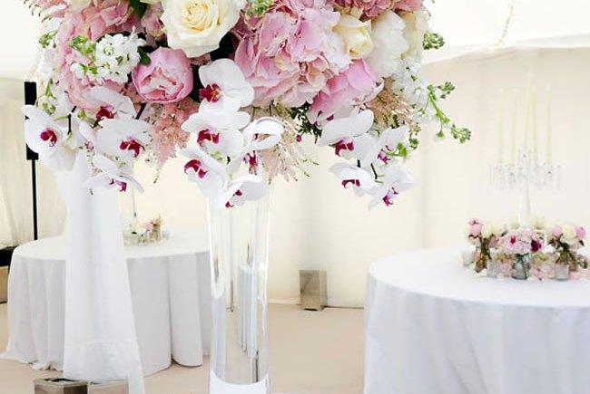

Although I am no fortune teller, Wedding Season 2015 is right around the corner. Join Muse Events in the upcoming trends that are about to emerge.

For starters, off-the-shoulder necklines will soon be coming our way. This is amazing on brides who want a sleeve but don't want to be too covered up. This adds a modern day look to the typical bride sure to be a jaw dropper.

Now for the creativity, convertible skir

ts. This is adding such a versatile look for a whimsical, fantasy wedding great to suit the bride's comfort having the option to take the tulle on and off.

High illusion necklines? Collars will do the trick. Adding a vintage flare has never gotten easier using lace-tops for a gentle touch.

Want a wedding like Kim and Kanye's? No problem. Now 2015 is introducing Luxe Bouquets avoiding stems and foliage choosing Hydrangeas and Orchids in pastel colors, it may be pricey but the sight and smell of fresh flowers is always worth it.

Spring Wedding Colors: Elegantweddinginvites.com has predicted the top colors for the spring of 2015 being: aquamarine, scuba blue, lucite green, classic blue, toasted almond, strawberry ice, tangerine, custard, marsala, and glacier gray adding color to bouquets, bridesmaid's dresses, and decor for your perfect day.

#weddingseason #weddingtrends #weddingcolors #museevents #luxebouqets #bouquets
