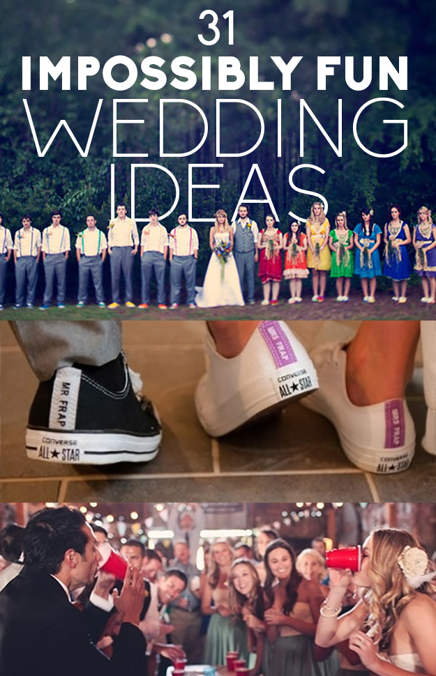

1\. Have a pre-wedding field day so your groomsmen and bridesmaids can get acquainted with one another.

2\. Add a line for a DJ song request on your RSVP cards. 3\. Enlist your grandmas to be your flower girls.

4\. Serve your drinks on “My Two Cents” coasters.

5\. For a brunch reception, serve up a waffle bar. 6\. For seriously rad photo ops, give out sparklers as favors.

7\. Crown your wedding day with a fun cake topper 8\. Incorporate your love story into the aisle runner. 9\. Hire a rad food truck for a late-night snack. 10\. Order your very own wedding Converse as dancing shoes for the reception. 11\. Have your very own beer bar. 12\. Or rent a Pub-Hub for a DIY bar area. 13\. Get everyone to dance on a GLITTER DANCE FLOOR. 14\. Instead of wedding favors, let people fill up bags with the candy of their choice. 15\. Include an inspirational quote from vodka.

16\. Leave out advice cards near the guestbook or on the dinner tables.

17\. Sometimes an array of bridesmaid dress colors can look prettier than just picking one.

18\. Let people DIY their own confetti combo. 19\. Decorate the bathrooms entrance with childhood photos.

20\. Keep the program simple and to the point.

21\. Play a game of “flip cup” for your after-party.

22\. Be dance-floor-ready in seconds with a transformer wedding dress from full skirt to mini skirt.

23\. For an outdoor summer wedding, serve up some alcoholic Otter Pops.

24\. Put crayons at the kids table with a butcher paper overlay.

25\. Forgo confetti for pom-poms.

26\. Have a ball pit.

27\. Lose the bartender and serve your alcohol in water coolers.

28\. For dessert, display an ice cream bar.

29\. Or just have everyone dive face-first into a 10-foot-long banana split.

30\. Forgo the typical bouquet for one big-ass paper flower.

31\. Instead of a guestbook, have your guests leave a message for you in an “anniversary piñata.”

#bridesmaid #dress #fashionshow #formaldress #museevents #party #soiree #specialoccasion #wedding #blog #family #fun #personal #weddingideas #weddingtrends #eclecticweddingshowcase #museeventscoloradowedding
