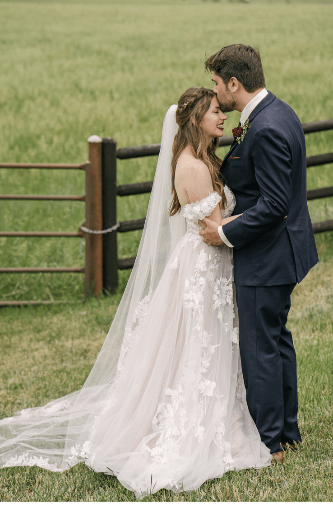
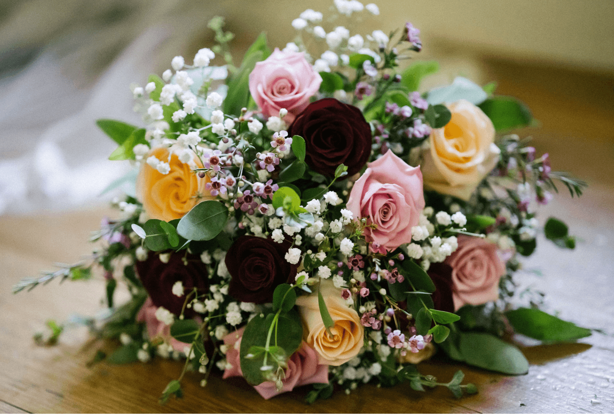
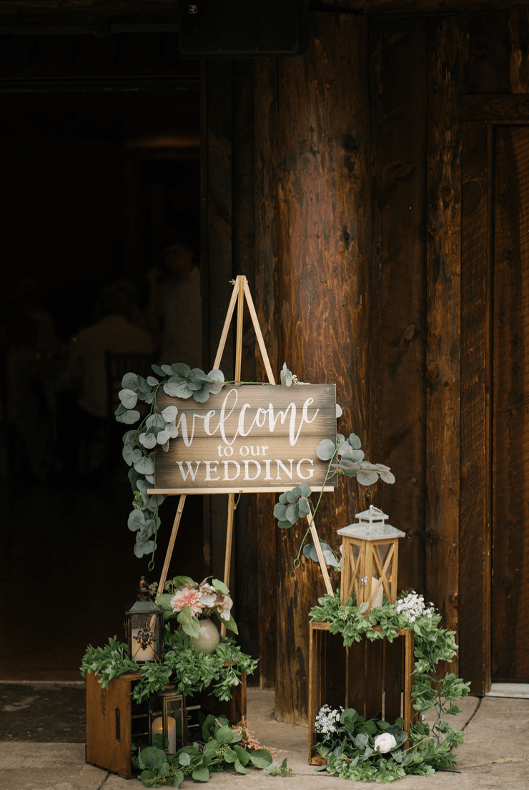
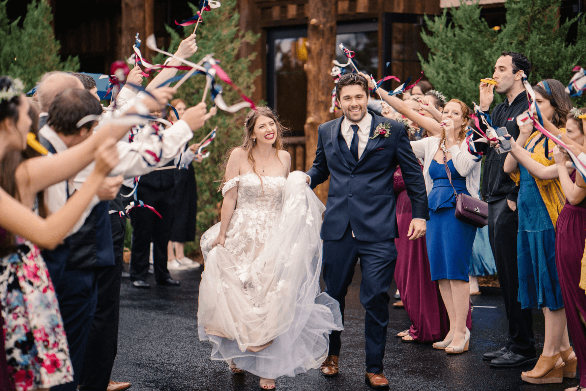

The sweetest couple, Andrea and Ryan were blissfully wedded on Sunday, June 30th at the Magical Spruce Mountain Ranch. The sun was shining down on the couple’s mid morning ceremony allowing a halo of sunbeams to frame the couple and their wonderful guests.

Nothing quite compares to a Colorado Summer Wedding, the sweet warm air and the vibrant colors of nature set the scene for the perfect event, especially a union between two lovers.

Ryan and Andrea's reception was filled with an Italian style buffet from Rocky Mountain Catering. Guests dined and chatted throughout the afternoon until it was time to cut loose on the dance floor.

An afternoon rain shower didn’t stop the fun but added an element of excitement and romance as the guests and couple continued to dance in the rain!

The couple left the venue in a receiving line almost as sweet as them. Guest waved ribboned and buzzed kazoos to send this happy couple into their new life as Husband and Wife.

Beautiful images captured by Nick Sparks Weddings

#weddingparty #weddingphotography #weddingday #weddingplanning #coloradowedding #museeventscoloradowedding #museevents #sprucemountainranch #weddingstyle #weddinginspiration
