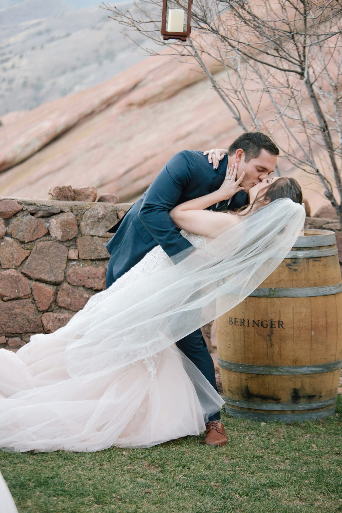
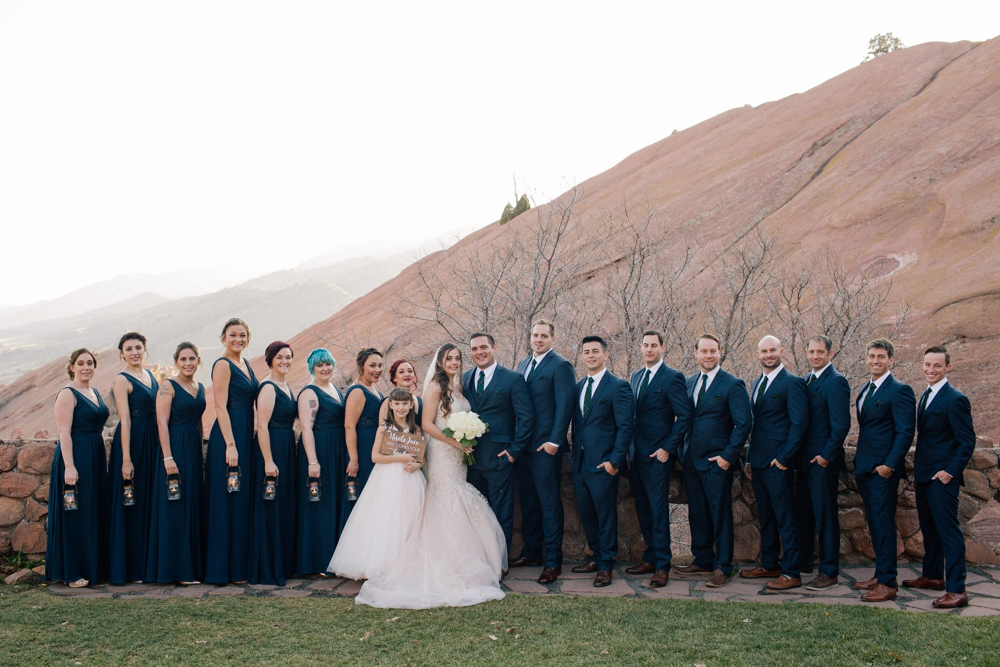
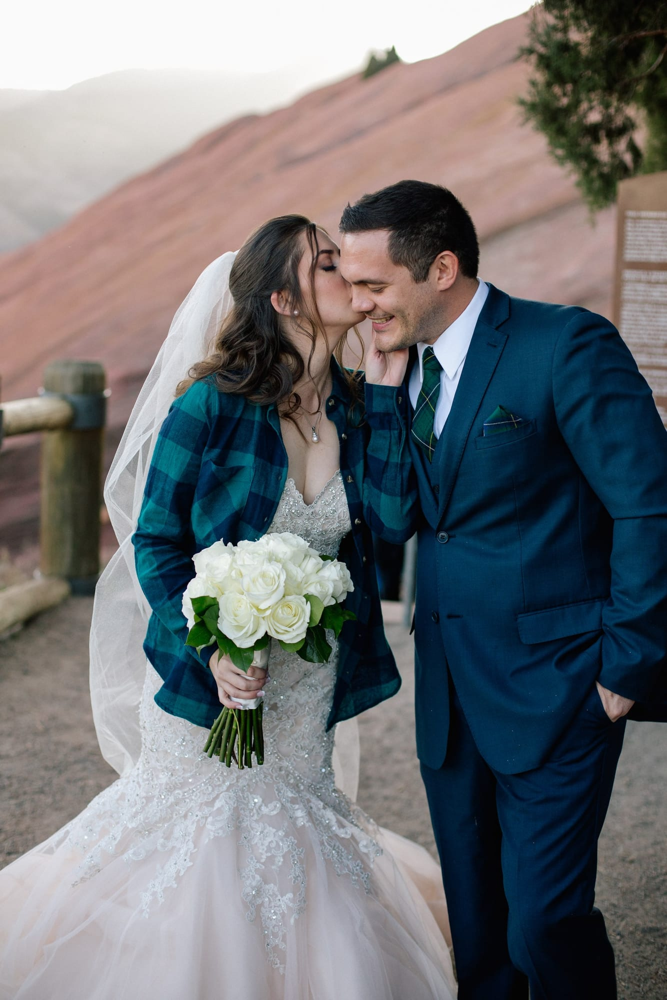

On the eleventh of November two thousand and seventeen, Melissa and Jace officially tied the knot. Surrounded by an abundance of love from their families and friends, the beautiful couple said “I do” at Red Rocks Amphitheater in Morrison, Colorado.

As the couple took scenic sunset photos with the red rocks on the horizon, the guests were asked to join the reception in honor of the newlyweds. The reception began overlooking the notorious theatre, with absolutely breathtaking views.

Concluding cocktail hour at the Shiprock Grille, the Bridal party was announced to “Thunderstruck”, leading into Beyoncé’s “Crazy in Love” where the couple ran in holding hands with beaming smiles on their faces. Everyone cheered as the music transitioned into Queen’s “Somebody to Love” and a “Crazy Little Thing Called Love,” where the Bride and Groom shared their first dance.

The guests were then invited to dinner and the toasts began. The best man and maid of honor raved about Melissa and Jace, wishing them a lifetime of happiness and love.

“Cake by the Ocean” played as the newlyweds cut their cake. The remainder of the night was filled with great music and laughter. Everyone continued to dance the night away through the Traditional Mexican Dance, to the Bride surprising her Groom with Guitar Hero, so that he could officially say that he has “played Red Rocks.”

The exciting, musical celebration with family and friends concluded with Jace carrying out his Bride, Melissa, to Bon Jovi's “Living on a Prayer.” Surrounded with those who love them most, the guests cheered for the Bride & Groom. This beautiful evening, was definitely a night to remember. Congratulations Jace and Melissa!!!
