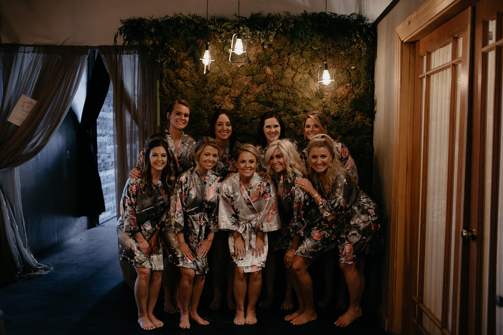
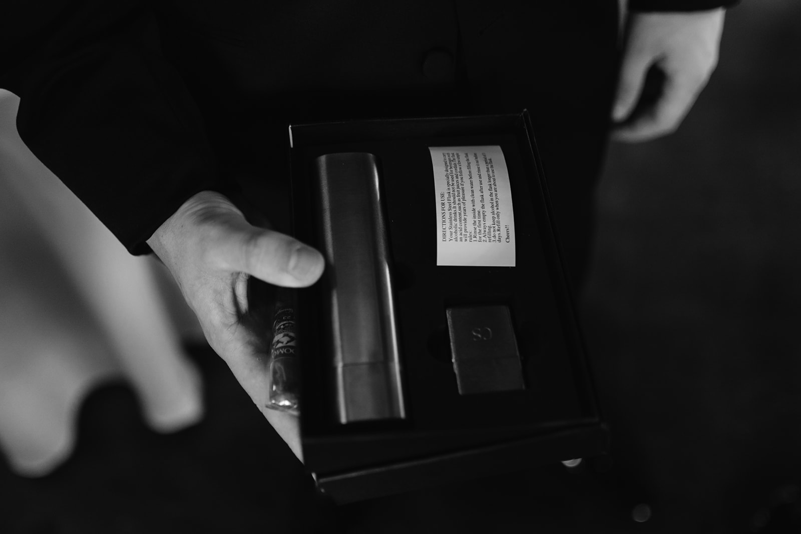

## Wedding Party Gifts

We dream of our big day since we are little girls. From who will our prince charming be, what our wedding dress will look like, to who is going to be in our bridal party on the big day. When the time comes, we ask our best friends and family to be part of the celebration. But how do we thank them? On this Wedding Wednesday, we are going to talk about our 5 top gift ideas for the bridesmaids, groomsmen, and anyone who is part of the big day.

“It’s not about how much we give, but how much love we put into giving”

### **For the Girls**

Robes with embroidered names or monograms

Matching Jewelry

Small bottle of wine

Make up bag

Thank you Note

### **For The Men**

Flask with Groomsmen’s names engraved

Custom or matching ties/socks for the big day

Cigars

Men’s Travel Bag

Thank you Note

We know weddings come with a budget, but your parties happiness should not! A great way to get these items is by using websites such as Pinterest, Etsy, or gift making could turn into a fun DIY project.

#gifts #bridesmaid #groomsmen #weddings
