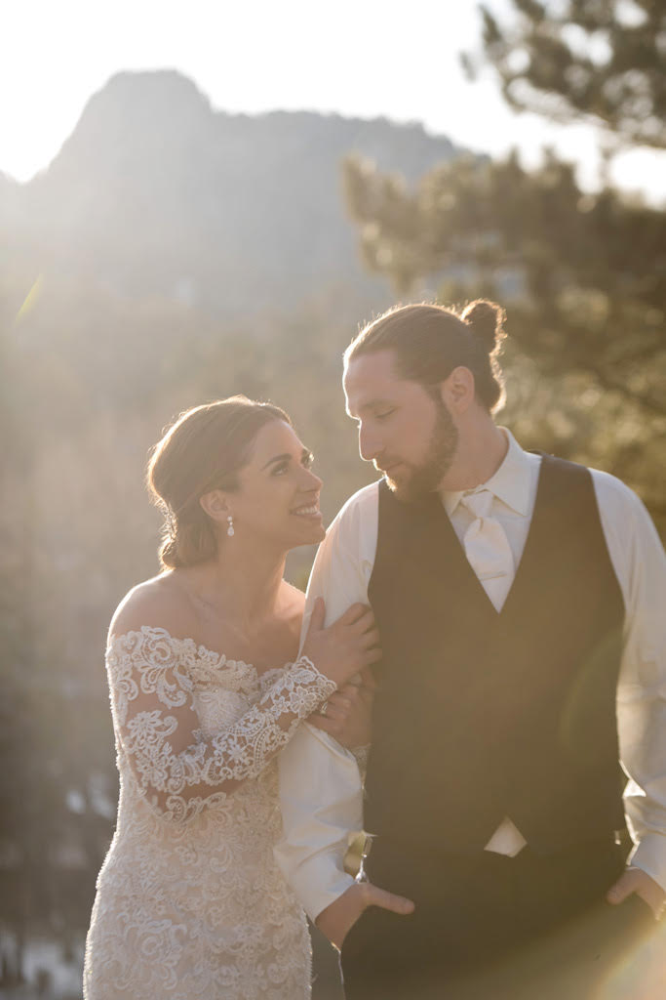
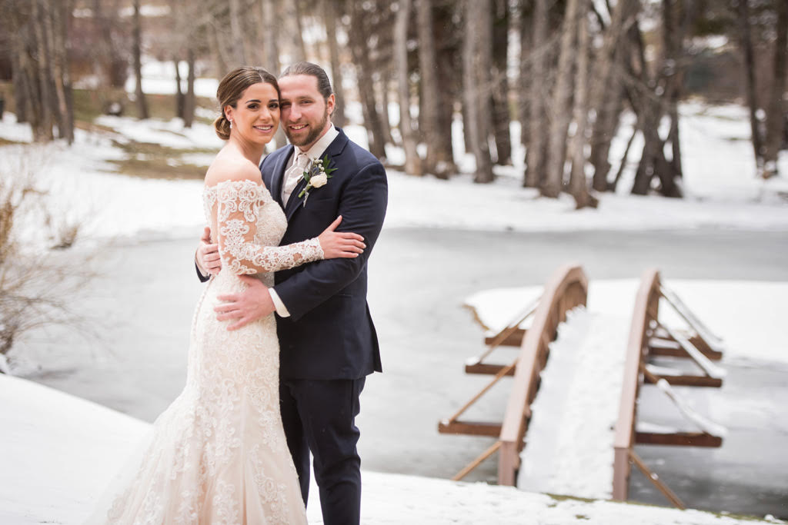

Underneath the snow-frosted trees of Estes Park, Camila and Paul tied the knot!

This beautiful storybook wedding took place on April 13th, 2019 at Black Canyon Inn. Following a snowy 24 hours, the sun slipped through the peaks just in time to illuminate this lovely couple during their outdoor ceremony surrounded by mountains and fresh Eucalyptus.

As the ceremony drew to a close the guests paused for a memorable group picture and then gathered for a cocktail hour to enjoy drinks, Hors d’ oeuvres, and most of all each other.

In the cozy cabin setting of Twin Owls Steak house, dinner began with the Bride and Groom receiving their dinner plates to the sounds of the Disney classic “Be our Guest” . This sweet moment brought a smile to everyone’s face and set a fun and upbeat tone for the rest of the night.

Guests danced late into the night celebrating the new couple by shaking their maracas and enjoying pies, lemon bars and brownies created by Valerie at "You Need Pie!" After the reception, the altitude posed no limitation to the fun as the after party was held at The Ridgeline Hotel. It truly was a beautiful and memorable night.

Congratulations Camila and Paul!

Beautiful Photography captured by Mark Creery

#mountainwedding #wedding #bride #weddingday #weddingphotography #weddinginspiration #marriage #weddingparty #instawedding
