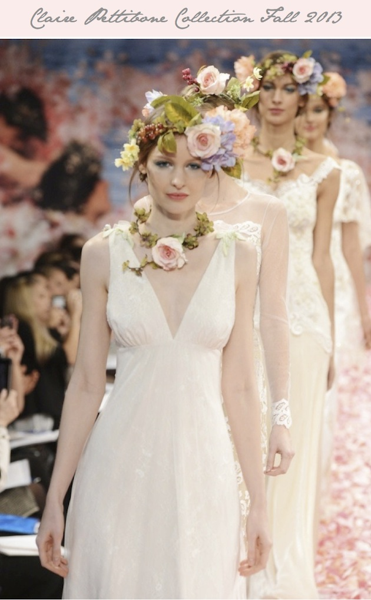

One of the most romantic bridal gown designers, I love Claire Pettibone's designs. Pair her style with a favorite Muse Events wedding boutique- the Little While Dress Shop and you have a love affair and an amazing trunk show. The Claire Pettibone Trunk Show is September 5–8.

Claire Pettibone’s Advice to Brides:“Be true to yourself”

“When considering a wedding gown, my advice is to choose something that moves you, that makes you feel happy and your most beautiful, that you know will melt your soon-to-be spouse’s heart.”

Claire won’t be here this time, but ALL her most recent, most fabulous, masterpieces will be! Enjoy all the gowns from her “An Earthly Paradise” collection, AND her most recent collection presented at April 2013 bridal market, AND past favorites.

Are you alternative, romantic, and feminine, and do you love all things vintage? Claire Pettibone gowns may be just perfect for you! Only available in Colorado at Little White Dress Bridal Shop! This is thier most popular trunk show each year, and appointments book quickly, so please call today! 303-814-8972 – See more at: http://www.lwdbridal.com/the-events/#sthash.EGwyefUq.dpuf

