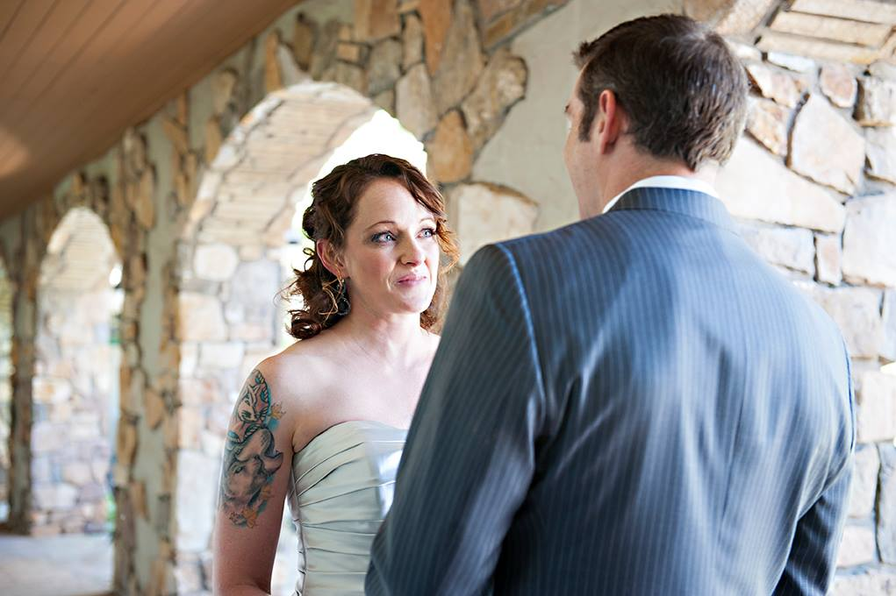
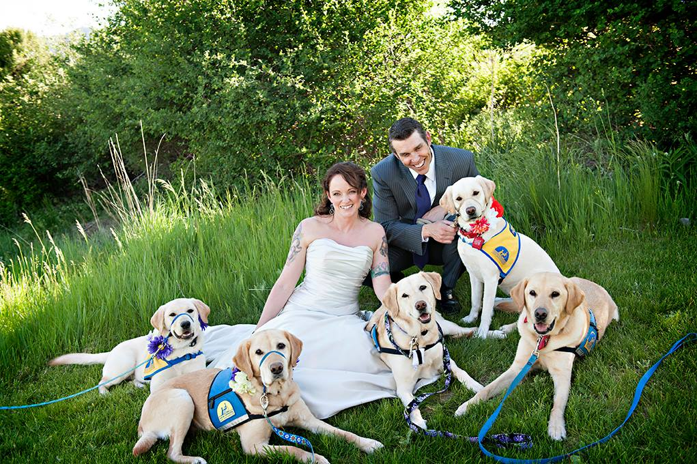

(Photos by L Elizabeth Photography)

On a warm, sunny evening with the Rocky Mountains as their backdrop, a gentle breeze rustling the trees, and 88 honored guests (and several honored canines) looking on, Amber and Gary exchanged their vows on the Overlook Lawn at the Cordillera. The couple also made beautiful tributes to family members who were no longer with them by adding pictures of them into the bride's purple and navy, rose bouquet as well as sharing some photos in a collage on their gift table. Following their ceremony, guests were invited to a cocktail hour, and then dinner in the Mirador Restaurant which was decorated with purple rose petals, childhood photos of the bride and groom, and tea lights in silver votives decorated with silver snowflakes to honor their passion for skiing. Adding a creative twist, the bride and groom also encouraged guests to sign a bottle of wine with their table number on it, which they will open on that anniversary year (so they will open the Table 5 wine bottle on their fifth anniversary) The bride and groom treated their guests to the Cordillera's rave reviewed mashed potatoes, a choice of a succulent pork loin with cherry demi-glaze or salmon with a cream sauce, asparagus, and a classic caesar salad. As guests enjoyed their meal, one of the groom's groomswomen/best friends treated the wedding to some of the bride and groom's favorite songs on her guitar. This wedding was truly a celebration of the things Gary and Amber love: each other, their family and friends, dogs, skiing, and whisky! They treated their guests to a private whisky tasting with some of their favorite whiskies. The festivities continued as Gary and Amber cut their chocolate, gluten-free cake, and treated their guests to individual Nothing-Bundt-Cakes in either red velvet, strawberries and cream, or chocolate chocolate chip flavors. YUM! As the sun set, Gary, Amber, and their families took pictures taken by the lovely Laura Pearson of L Elizabeth Photography to commemorate their special event, and the evening ended with dancing and a lot of merriment to conclude an absolutely special day.

#rockymountains #vows #ceremony #nothingbundtcakes #LElizabethphotography #museevents
