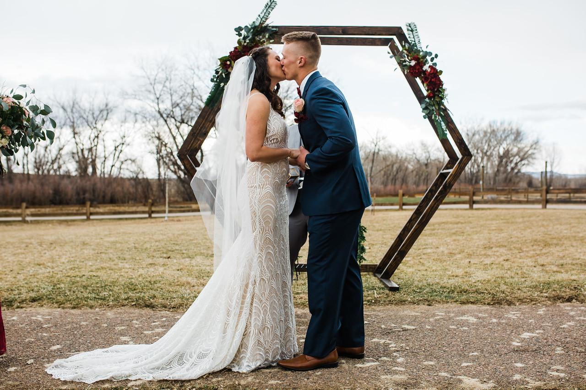
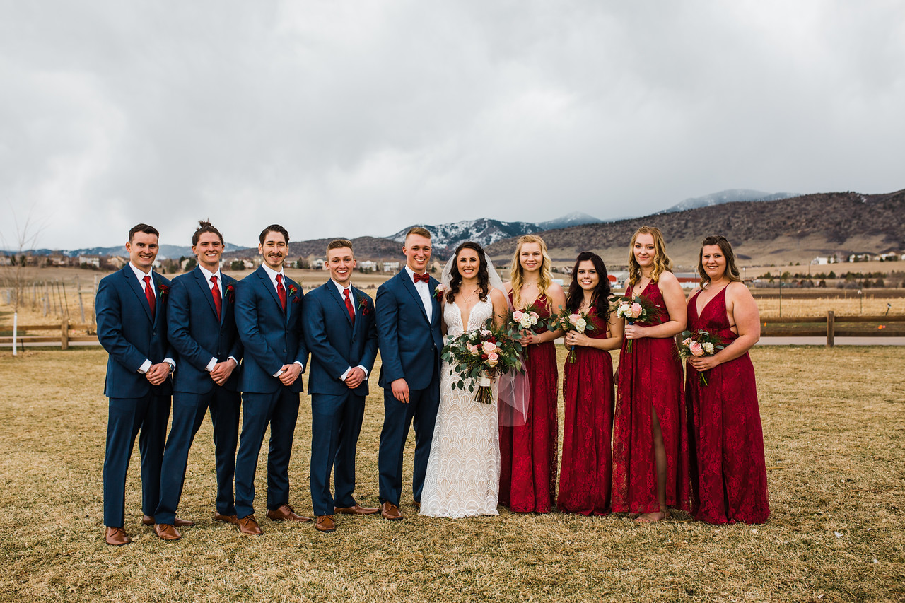
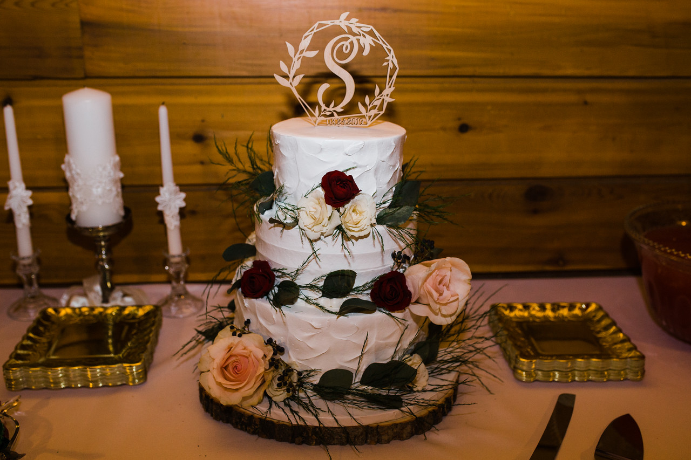
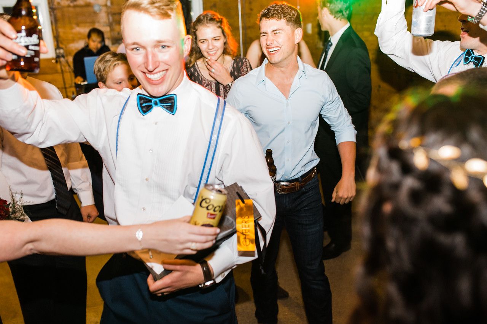
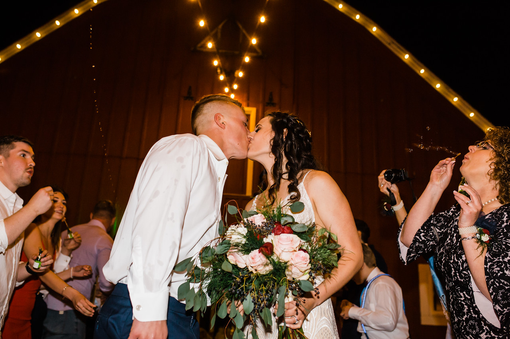

On March 24th, 2019 Cydne and Luke became one in front of family and friends.

The Denver Botanic Gardens at Chatfield was the crowning venue for Cydne’s and Luke’s outdoor nuptials. Their ceremony took place in front of a beautiful stained wood hexagon, elegantly framed with greenery and red flowers. The geometric shape offered a modern and romantic backdrop for the bride and groom to say I do. The bright red of the flowers coincided with the bridesmaid’s gorgeous red dresses, presenting a beautiful contrast when standing by Cydne in her stunning white gown.

After the ceremony, the guests attended a cocktail hour where they sipped and mingled until dinner. Dinner was deliciously catered by Famous Dave’s BBQ. When dinner came to an end, a champagne toast preceded the cutting of Cydne’s and Luke’s three-tier white cake which roses and greenery rested upon.

Continuing the night...

the bride, groom, and guests all let loose on the dance floor until the bride and groom departed with a bubble send-off from their family and friends. Bubbles and kisses perfectly cap off a day that Cydne and Luke will never forget!

Images captured by Cambria Raggio

#instawedding #weddingparty #weddingday #weddingphotography #weddingplanning #bride #bouquets
