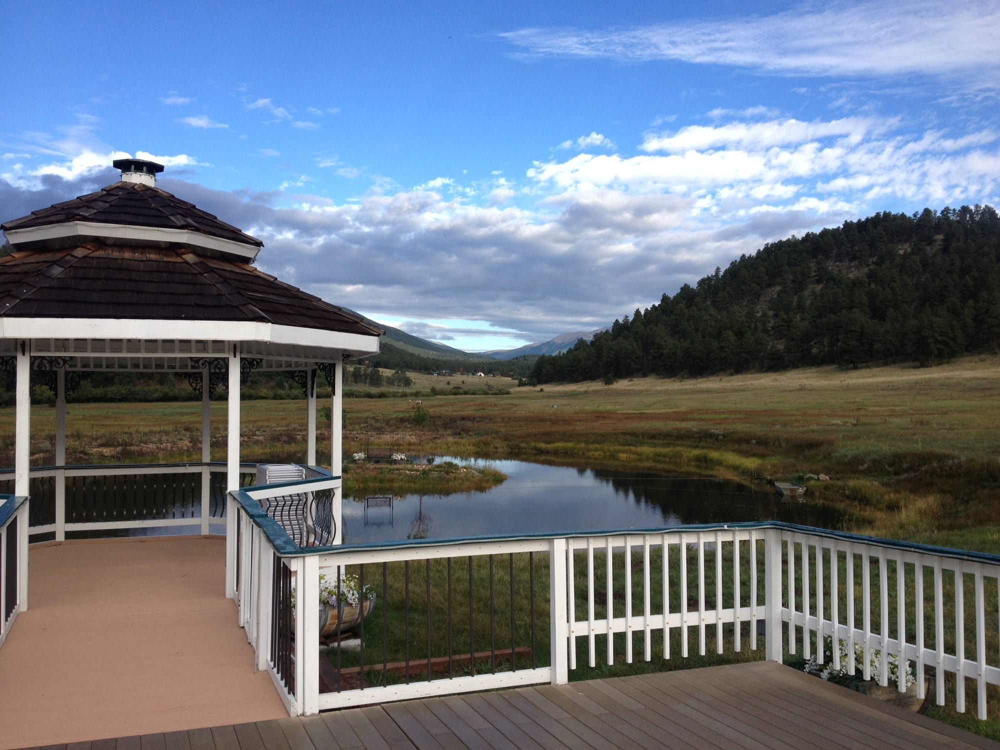

Today we have the pleasure of coordinating a wedding at Deer Creek Valley Ranch in Bailey Colorado. Their outdoor ceremony and event sites include a lake-side Gazebo and the Meadow at the Covered Bridge with gorgeous views of Mount Evans. Receptions and ceremonies are also held in the barn. The Historic Barn, originally built in 1865, has been completely restored to give guests a true Colorado experience. Great care was given to every detail right down to the bar stools made from horse saddles.

#museevents #wedding #nature #weddingplanner #weddingtrends #deercreekvalleyranch #beauty #weddingideas #weddingplanning
