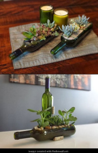

What is a DIY? Well it stands for "Do It Yourself." It's a fad that many people are finding to be a fun hobby. With Spring here and summer right around the corner, gardening season is here as well! So a mini garden would be the best of both worlds. Just turn your old wine bottles into little gardens you can keep right on top of your counter inside the kitchen!

Materials:

-   Wine bottle

-   Sharpie marker

-   Glass cutter or Exacto knife

-   Candle

-   Bowl of cold water

-   Sand paper

-   Plants of your choice!

Directions:

-   With any and all labels taken off of the wine bottle, use the Sharpie to outline exactly where you would like to cut the glass (lengthwise).

-   Use either an Exacto knife or glass cutter to score the bottle along your Sharpie outline.

-   Use thermal shock to cut the glass! First heat where the bottle is scored by moving it along the flame of your candle. Then, dip the side you want cut off in your bowl of very cold water for 30 seconds or so. Repeat the heating and cooling until the bottle splits.

-   Use your sand paper to smooth any rough edges from cutting the glass.

-   Put in your choice of soil and plants and let them grow!

Although this project might be a little challenging for some of you, the end result is totally worth it because it makes a great, unique decoration.

#museevents #diy #garden #winebottles #plants #centerpieces
