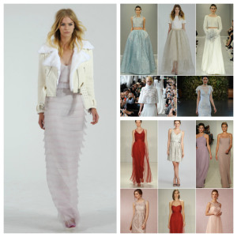

Saying “I do” with snow on the ground and icicles hanging from the windows… Sounds like a winter fairy tale. Well some of the most memorable winter trends come from this past wedding season! Definitely different, but perfect for the cold, faux fur was a great way to keep warm and fashionable (left picture). A full on fur coat or just a fur shawl accessorized many brides this winter. Next is the most daring trend: two-pieces! This trend is making a stand in all parts of the fashion-world like everyday or even prom ensembles for teens, but its stand in weddings this winter is unexpected. The complement to these two-pieces is a beautiful ice blue (top right). Don’t forget about the bridesmaids though! Lately, many brides have chosen striking, metallic-lace dresses for their maids (bottom right). The metallic keeps any color a tad bit cooler to go along Saying “I do” with snow on the ground and icicles hanging from the windows… Sounds like a winter fairy tale. Well some of the most memorable winter trends come from this past wedding season! Definitely different, but perfect for the cold, faux fur was a great way to keep warm and fashionable (left picture). A full on fur coat or just a fur shawl accessorized many brides this winter. Next is the most daring trend: two-pieces! This trend is making a stand in all parts of the fashion-world like everyday or even prom ensembles for teens, but its stand in weddings this winter is unexpected. The complement to these two-pieces is a beautiful ice blue (top right). Don’t forget about the bridesmaids though! Lately, many brides have chosen striking, metallic-lace dresses for their maids (bottom right). The metallic keeps any color a tad bit cooler to go along

#beauty #blog #design #events #eventplanning #family #fashion #fun #inspiration #life #love #nature #photo #personal #photography #photos #pictures #relationships #wedding #weddingideas #weddingplanner #weddingplanning #weddingtrends #weddings #museevents #museeventscoloradowedding
