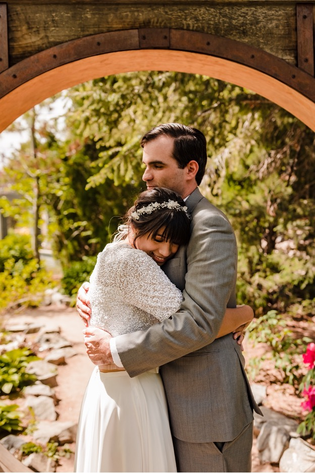
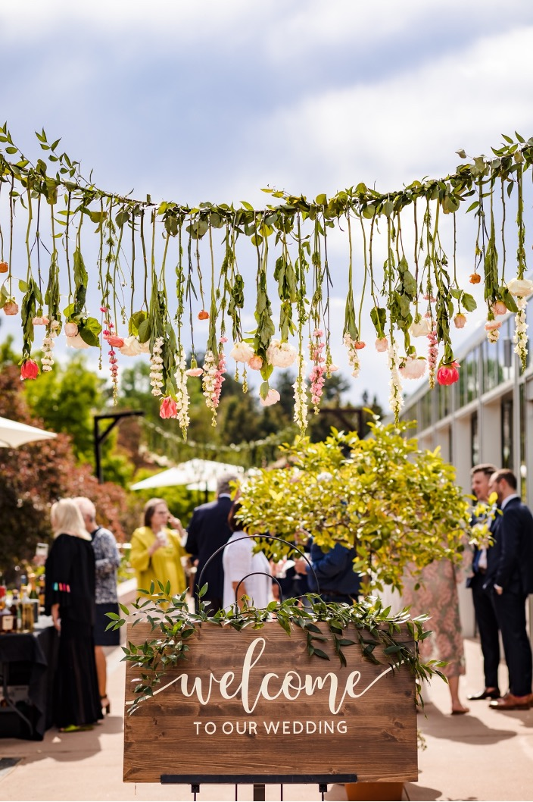
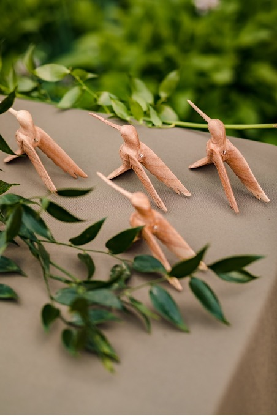
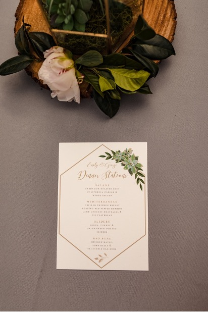
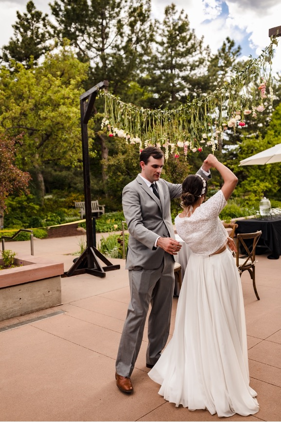
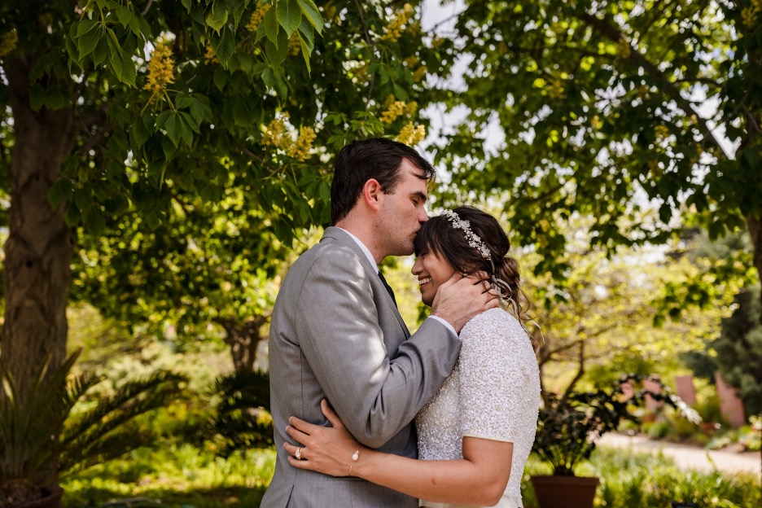
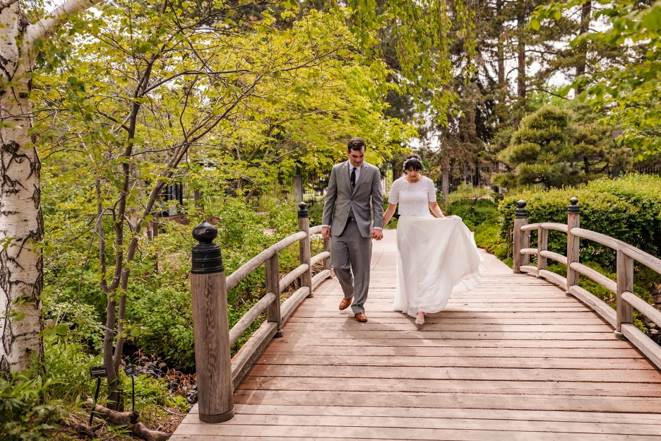

To kick off the 2021 wedding season our team at Muse had the opportunity to witness the celebration of Emily and George’s unity in the luscious Denver Botanic Gardens. On May 28th the warm sun shone brightly while guests enjoyed the sound of a beautiful quartet, refreshing cocktails, and delicious bites.

To start off the evening, Emily tucked away in the beautiful abundance of greenery within the gardens, George was guided to see his beautiful bride for the first time. As the couple returned, their guests awaited them in the Orangery, an indoor-outdoor space decorated with vibrant pink roses, an array of greenery and spring inspired florals.

As guests arrived, they were greeted with handcrafted wooden hummingbird ornaments with the couple’s initials as favors. The guests enjoyed passed hors d'oeuvres from Catering by Design and mingled leading up to the opening of the Chef operated dinner stations. The dinner stations featured a wide variety of cuisines. The couple offered a slider station, Mediterranean station, a bao bun station, and salad station. The Mediterranean chicken salad was unbelievable! While the fried green tomato slider offered a uniquely delicious flavor profile.

After the guests enjoyed their dinner followed by a wonderful dessert bar, the quartet continued to play while guests gathered around for the couple’s first dance. A heartwarming experience for all as George twirled Emily around the dancefloor.

The night was finished off with laughter and good conversation as the sun set and the cool summer night made an appearance.

Emily and George, congratulations on a lifetime of love and comfort. You both were wonderful to work with and we cannot be more proud to have been chosen to spend the evening celebrating alongside you two!

Photos by Erin Witt Photography

Florals by Kimball Floral

Catering by Catering by Design

Venue Denver Botanic Gardens
