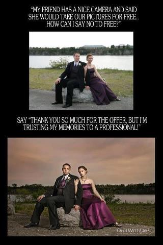

When interviewing photographers, it is important to consider their overall photographic talent and ability. Ask to look at samples of their portraits, landscapes, and personal interest photographs. Pay attention to their responsiveness to your questions, interest in your wedding, commitment to understanding your vision for your wedding photography and the ability to design a beautiful album. It is extremely important to find a personality that suits your own personal style, as you may be working with your photographer for up to one year after your wedding.

Tip: All photographers offer different products and have different shooting styles. Meeting with several photographers will help ensure that you have found the right one for you.

#events #family #photo #life #eventplanning #photography #photos #pictures #relationships #wedding #weddingideas #weddingplanning #weddingtrends #weddings #museevents #museeventscoloradowedding
