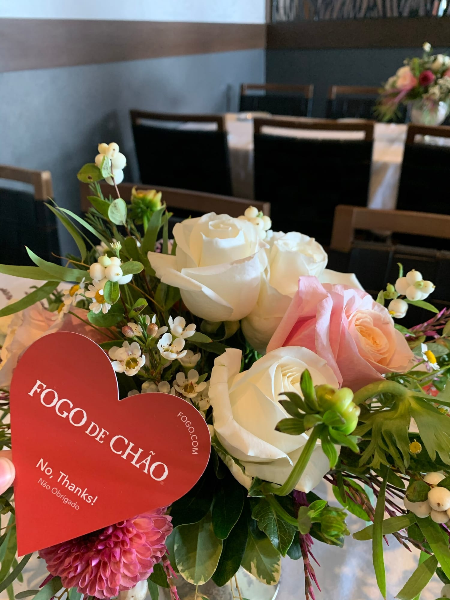
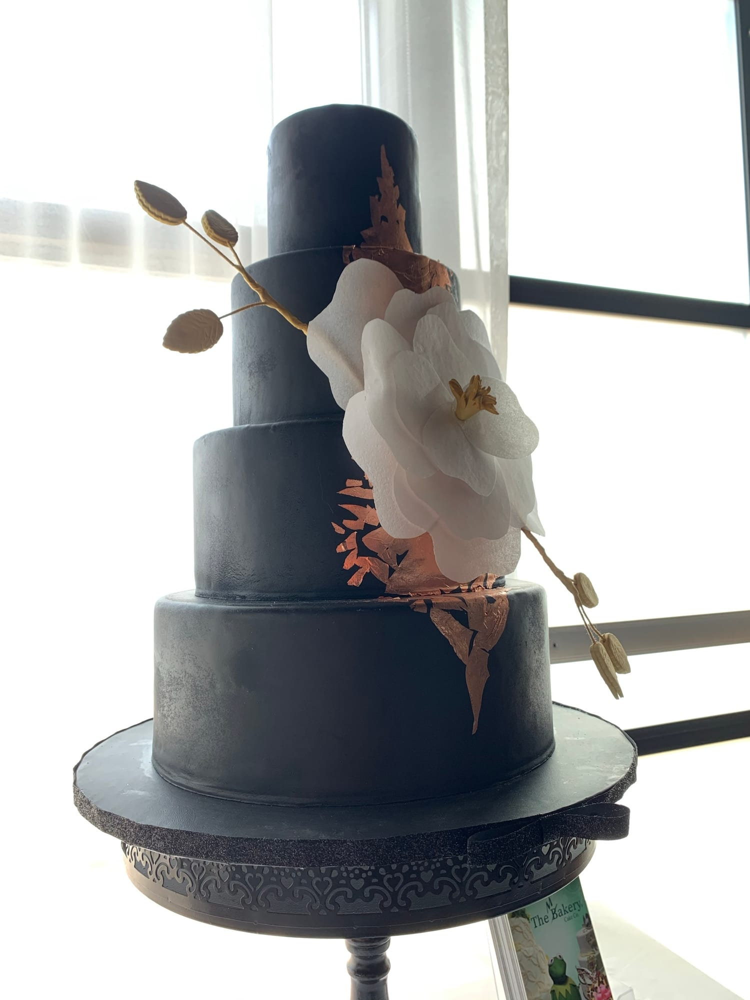
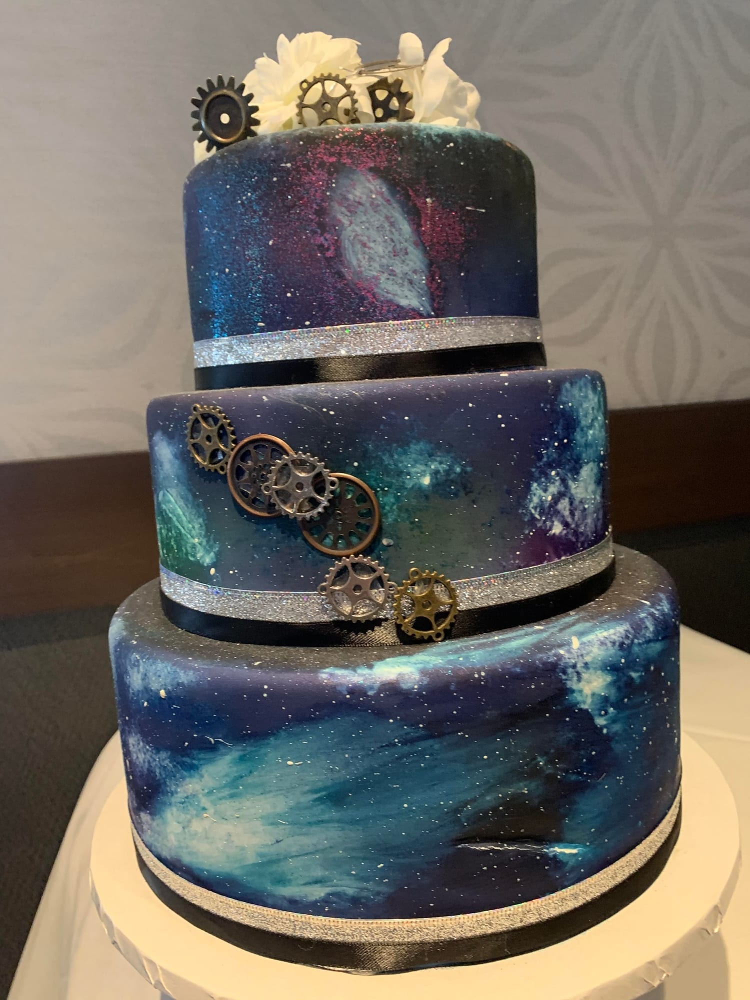
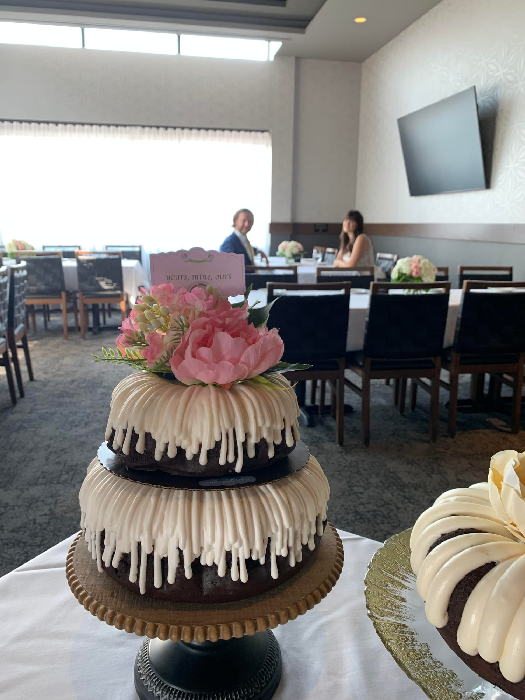
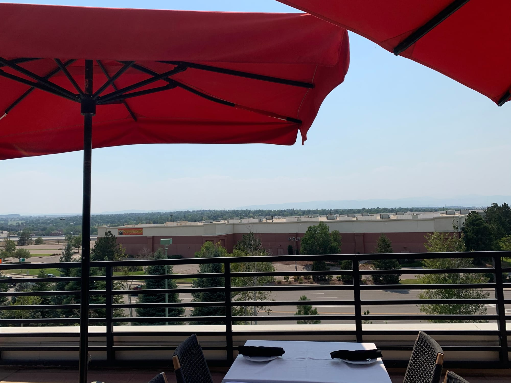
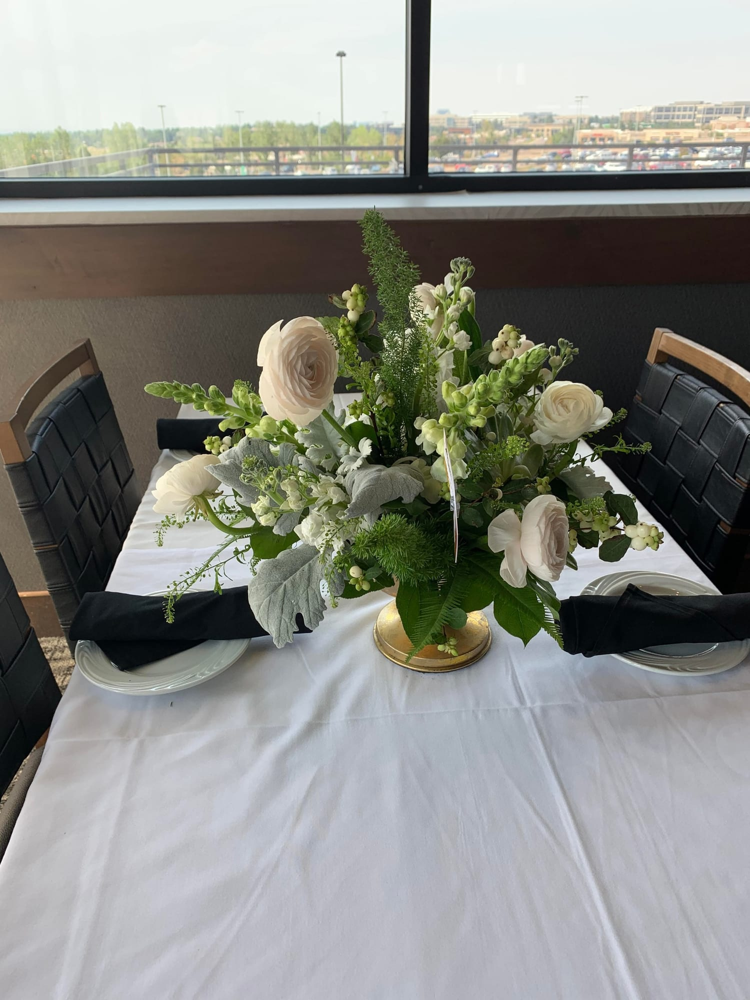
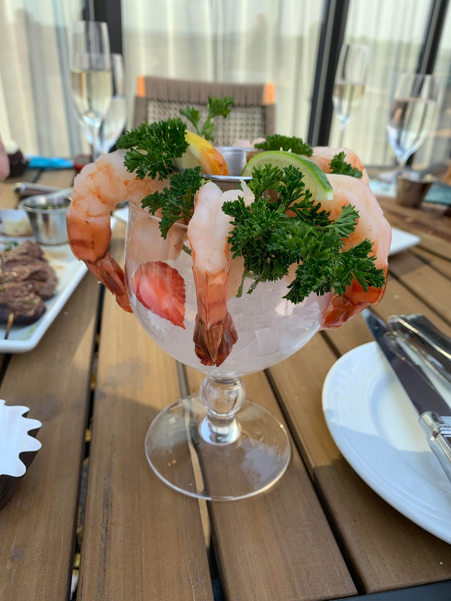

**Looking for the perfect venue for your wedding can take a long time, for the venue is the backdrop for your entire wedding. The perfect day begins with the perfect venue. With dozens of venues in Colorado, though, the venue search may feel overwhelming. That’s why when Fogo de Chao, a Brazilian steakhouse in Lone Tree, reached out to us about a wedding showcase, we jumped on it! Here’s the scoop on this unique venue.**

**My first stop of the tour was a beautiful dining space located behind the Fogo de Chao bar. Separated by glass walls from the rest of the restaurant, there is something special about this space. With the curtains drawn open, the space could almost feel like a fishbowl, with everyone on the outside looking in. But if anything, this added to the feel of the room, for what would be an intimate gathering felt like a larger celebration. Large windows allowed plentiful natural light to spill into the room, providing a beautiful glow that I believe would result in some magnificent photos.**

**The next space was tucked next to Fogo de Chao’s market table (an idea inspired by the grand Brazilian kitchen tables overflowing with freshly harvested goods). Now, one of my favorite parts of any event is always the food, so the proximity of the market table was definitely a draw for me to this space. While this space is a lot smaller than the others, the environment is so nice that it would work beautifully as a rehearsal dinner location.**

**Just to the left of this space was yet another, flushed with light and**

**practically asking me to come in. While the first two spaces have felt very much a part of the restaurant, this space felt the most separate, with only one side of the room visible to patrons outside. Maybe it was the Nothing Bundt Cake I was given, but that room was positively sweet.**

**The final two spaces within the Lone Tree Fogo de Chao were located on**

**their second level, accessible by both stairs and an elevator. Once at the top, I was greeted with a large open room. If you were wanting to have a larger gathering, this would definitely be the space to have it in, especially once the doors to the patio were opened up.**

**The patio is Fogo de Chao’s pride and joy, offering a breath of fresh air alongside its elegant ambiance. While there would typically be a gorgeous mountain view, I unfortunately visited while the fires were burning across Colorado, making the air smokey and hiding the mountains. Still, there was a view to enjoy. This gorgeous patio would make for a fantastic cocktail hour before guests could move inside for a reception.**

**Before I left, Fogo de Chao offered me a few bites that sounded about as delicious as the venue was beautiful. Now, if there is one thing you take away from this, please let it be that the food at Fogo de Chao is absolutely amazing. Enjoying it out on their patio was a highlight of my trip, and I’m sure it would be a highlight of any wedding. Even if a different venue speaks to you, Fogo de Chao offers some catering options that would complete your perfect day. In the end, I think any couple that decides to include Fogo de Chao in their special day will walk away with everything they could ask for and more.**

**Vendors featured from top to bottom:**

**Arapahoe Florals**

**The Makery**

**The Makery**

**Nothing Bundt Cakes**

**ABloom Flowers**
