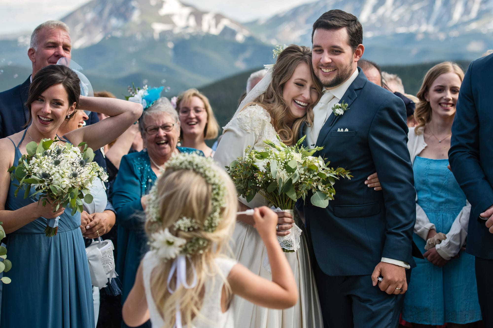

On a beautiful Saturday afternoon, Holly and Trevor decided to say “I do” on one of Colorado’s most beautiful landscapes, Keystone Mountain. The ceremony included warm laughs and loving sentiments, all while taking in the crisp air of Colorado’s mountainside.

The cocktail hour was filled with meaningful and endearing details that made all the guest feel apart of something special. Whether it was the mini grilled cheeses or the incredible live music, everyone found something they loved.

The reception was filled with many moments that will be looked back on and smiled about for years to come. Everyone could feel the joy in the room when the bride and her father started dancing to Beast of Burden or when they got a glimpse of the most beautiful wedding cake with pine cone toppers. The night was filled with great food and lots of dancing, but what made the night special was how much love was shared between the bride and groom.

Photos Captured by Mark Creery Photography
