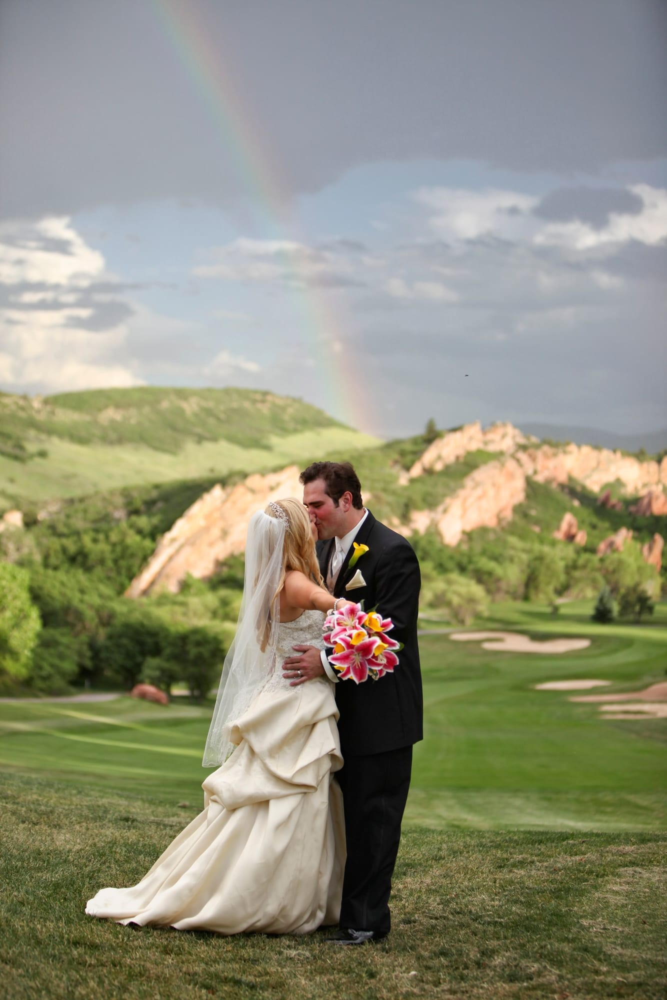

Photojournalism vs. Traditional Photography

Although many bridal magazines and blogs advocate a “photojournalistic” style, most brides wish for a mixture of candid and posed photos. The definition of a photojournalist is a photographer who documents what happens and never interferes with or poses his or her clients. However, it is the rare bride and groom who would not want at least a few posed images. The vast majority of photographers offer a mix of both photojournalistic and posed images. Be sure to ask whether your photographer is willing to create the images that are most important to you.

Tip: Don’t be surprised if your photographer asks you to burst out laughing or sashay slowly down a grassy hill. Many times a “candid” moment is actually staged by the photographer.

#denver #dress #museevents #romantic #wedding #weddingdress
