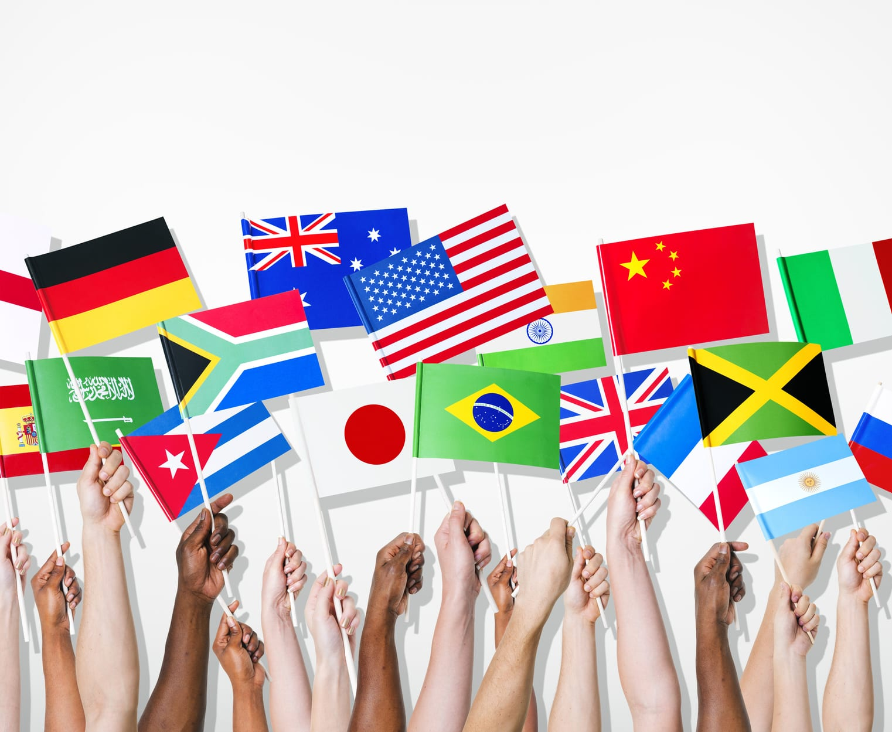

International traditions are lifetimes and generations of rituals passed on and definitely some fun facts to read about that cross continents. Germany’s off the beaten path wedding tradition when showcasing compatibility is for the Bride and Groom to race off and saw a log together in a “Ruggedly Romantic” ritual. Scotland’s forever traditions is to get the couple liquored up, cover them in ash, flour, and feathers believed to ward off evil spirits. Sounds like fun. It is a tradition that dates back to the earliest weddings and is called “Blackening.”

Other fun facts from around the world include China, where the bride is carried by two or more men in a beautiful “Sudan Chair.” And the groom of Pakistan wares a “Necklace of Flowers.” The brides of India are “painted” with a paste from a cone shape tube in intricate Henna designs that are to ward off evil. Henna is a plant symbolizing good luck, health and sensuality, and is believed to provided positive vibes and attract good energy. Where as in Mexico, a “Second Bridal Bouquet” is carried as a tribute to the Virgin Mary, and Italy’s ” Wedding Confetti” is sweet treats that are handed out during the wedding celebration. For hundreds of years Korean wedding traditions for the groom is to present a “Wooden Goose” to the mother in law as a symbol of monogamous intentions.

Intricate Henna Designs painted on Brides of India.

Traditions have carried over the years in wedding ceremonies all over the world and are now turning into trending expressions of the bride and groom in today’s ceremonies in the United States. Forever trends are now the blending of tradition with a trend of expression that creates a unique experience for everyone. Traditional church weddings are moving to the beautiful outdoors and Colorado is becoming one of the fastest growing destination wedding spots in the country, as it boasts over 200-300 sunny day’s of the year along with sustained warm and cool temperatures for outdoor wedding venues and urban chic celebrations.

With literally hundreds of wedding venues to choose from and ceremony decisions to be decided the blending of trends and traditions is now to create a unique wedding experience that is the expression of the bride and groom. Muse Events plans intricate details for one of a kind weddings. Openings for 2016 weddings lead the excitement for new trends in the upcoming year. For the wedding planner, this is taking the bride and grooms traditional wishes blended with the latest trends and painting an experience that showcases the uniqueness of the couple.

The Experience that “Showcases” the uniqueness of a couple.

Many traditions that are trending into expressions are now being captured with the traditional method of photography. Muse Events offers Brooke Summer, Sarah Roshan and Susan Pacek photography professionals that create a documentary of your day. Photography is an art, not only to create images but to capture the emotions of the wedding forever. Photographing a wedding is a tradition that changed following WWII that has now evolved into the fastest trending piece of a wedding.

Other traditions that are transforming into forms of expression for the bride and groom are the food, cakes, floral, entertainment, and videography. Traditionally wedding cakes have been the symbol of fertility. Kelley’s Kakes and Sinful Cupcakes will guide the bride and groom into keeping with the tradition or creating an expression of trend that reflects what is best for the sweet of the wedding that may not be a traditional tiered wedding cake. A cake can be a work of edible art or trending in deserts that are the planned treat for everyone to help themselves.

Trend and Tradition creates Edible Art!

Food Celebration is hands down Biscuits and Berries catering forte and offers this “Symbol of uniting and strengthening a common identity” celebratory tradition to be expressed into a one of a kind bread breaking event created by their expertise and the couples idea of creating a great time surrounded by food and drink.

Tying everything together the wedding bouquet is about bringing beauty and personal expression of the bride to the ceremony. Bella Calla, Perfect Petal, and Plum Sage are the amazing floral vendors of Muse Events. They have the ability to create the one of a kind floral symbol with exactly what the bride cherishes to carry for her day. Each of these traditions are now held with expression and symbolism that are created specifically for the bride and groom by the bride and groom with a grand wave of a wand by Muse Events. Planning will go above and beyond to ensure a one of a kind event that reflects the couple, stemming with trend and tradition but mostly the expression of the bride and groom as a couple.

#traditions #museevents #international
