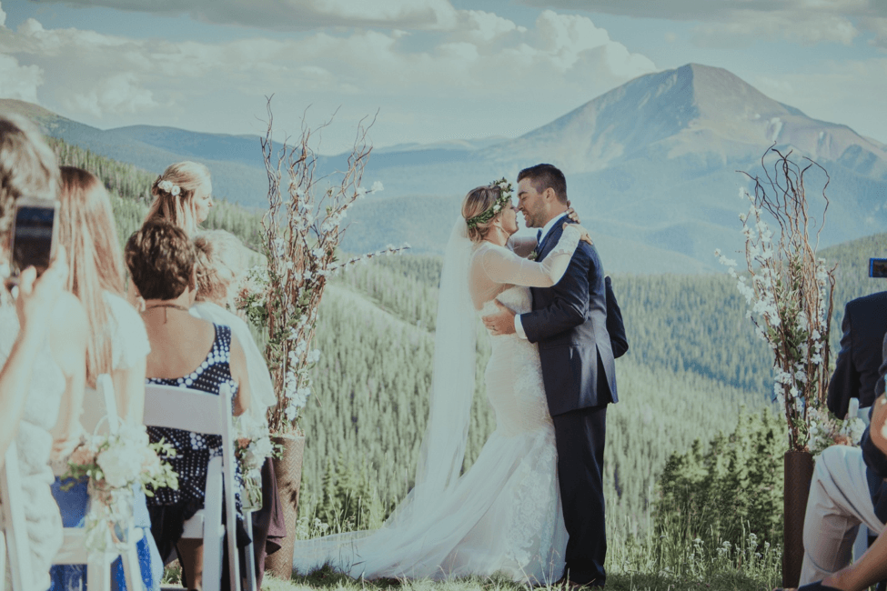
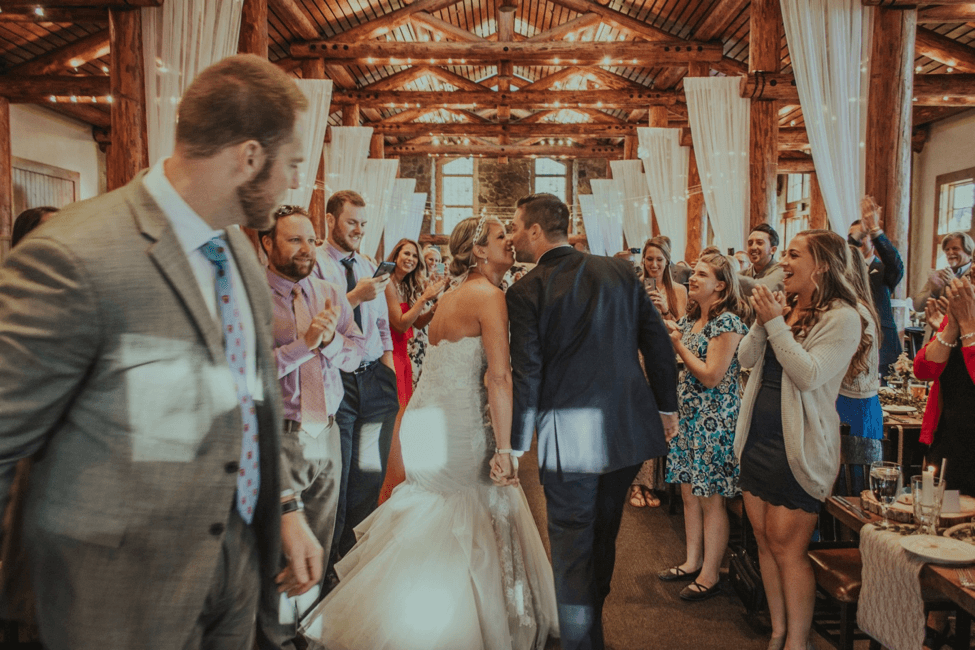
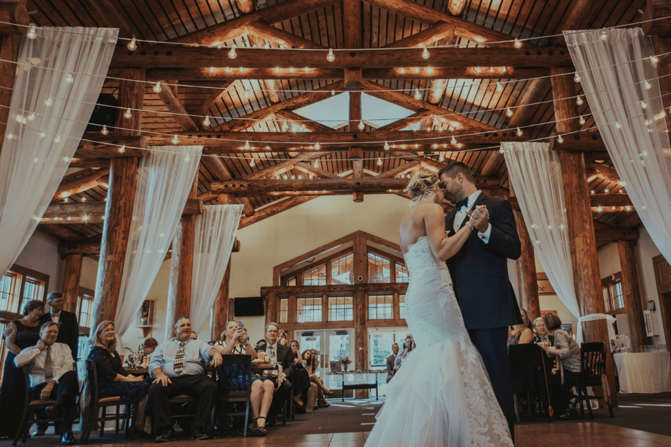

Lindsey, Jared, and their wedding guests went to the ski run in Keystone for this once in a life time wedding. The ceremony began the night before at their rehearsal dinner which took place in the courtyard outside of the Zuma Roadhouse. The wedding festivities began the next morning which was going to be the biggest day of their lives.

On their wedding day, Jared was not able to see his bride for the first time until Lindsey walked down the aisle at 5:00pm that evening. As Lindsey was walking towards her husband-to-be, the song “Can’t Help Falling in Love with You” by Ingrid Michaelson was playing - it was the perfect sight. Once they were standing next to each other, in front of their family and friends, they exchanged their vows and the rings; and the newlyweds kissed and were presented to their family and friends for the first time as Mr. and Mrs. Jared Strayer!

Once the ceremony was over, the bride and groom took off to take photos and their guests enjoyed the cocktail hour. As soon as that was over, everyone was asked to take their seats and let the party begin!

To kick off the party, the bridal party was announced and then Mr. and Mrs. Jared Strayer came into the party while the song “Top of the World” by Imagine Dragons was playing in the background. They must have felt on top of the world, since they were enjoying the best day of their lives. The couple enjoyed their first dance together and it was romantic as they danced to “Perfect for Me” by Ron Pope.

The bride and groom and all their guests were enjoying the party as there was a father daughter dance, memorable toasts being said and a bouquet and garter toss. As their wedding was coming to an end, the last song everyone was able to get up and dance to was “Uptown Funk” by Bruno Mars. It was a perfect way to end a perfect night.

#LindseyWentToJared

Photography: Taylor English

#museevents #skirun #keystone #zumaroadhouse #firstdance #perfectnight #weddinginspiration #coloradowedding #happycouple #wedding #weddingdress #weddingrings #weddingreception #weddingvendors #weddingideas #vows #photographers #weddingplanner #weddingplanning #weddingdecor #weddingday #timberridge #beautifulcoloradowedding #museeventscoloradowedding #keystonecolorado #colorado #keystoneskiresort #pictureperfectwedding #weddingceremony #taylorenglishphotography
