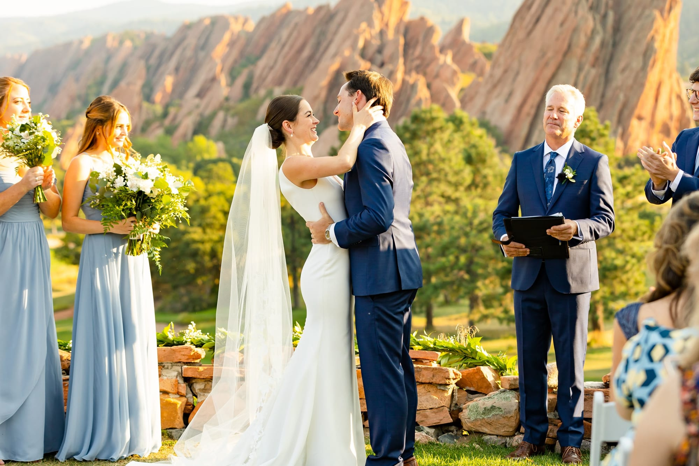
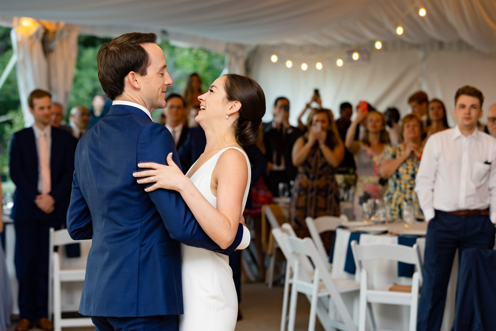
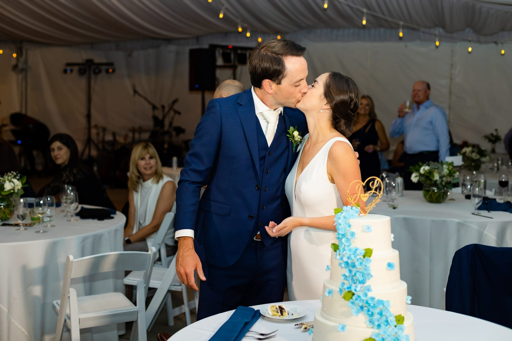
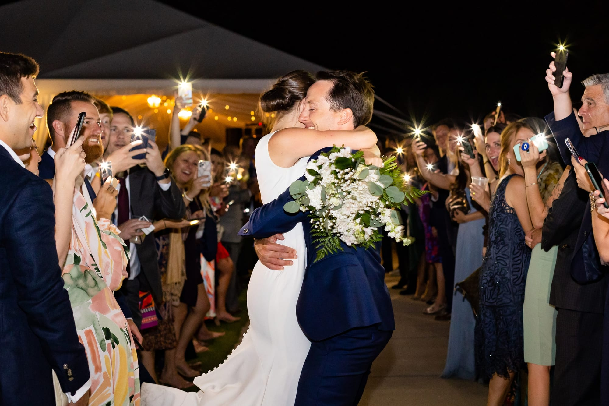

On a beautiful Sunday evening with a spectacular view of the Arrowhead golf course, Lisa met her soon-to-be husband for the first look before being accompanied by loving friends and family. The ceremony was in beautiful harmony as the bride walked down the aisle with a harpist playing in the background. Those who were gathered for this special day could feel the joy and love in the air.

Family and friends sipped on drinks, snacked, and mingled with a breathtaking view of the arrowhead rocks awaiting the grand entrance of Mr. and Mrs. Fowler. Lisa and Johnny shared their first dance as a married couple with a live band performance, followed by toasts from beloved friends and family.

Dinner was a selection of tasty food and sides, fueling everyone up to get ready to hit the dance floor. The night was complete with the fun-filled live music to Lisa and Johnny sneaking off to enjoy their cake. Everyone then danced the night away with the newly happily married couple.

It was such an honor to be able to share this day with Lisa and Johnny, may the joys they shared on their wedding day be a beginning to a lifetime full of happiness.

