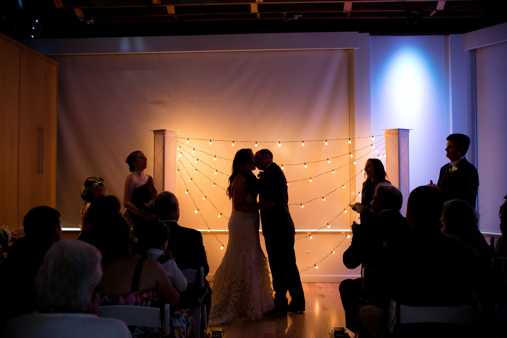
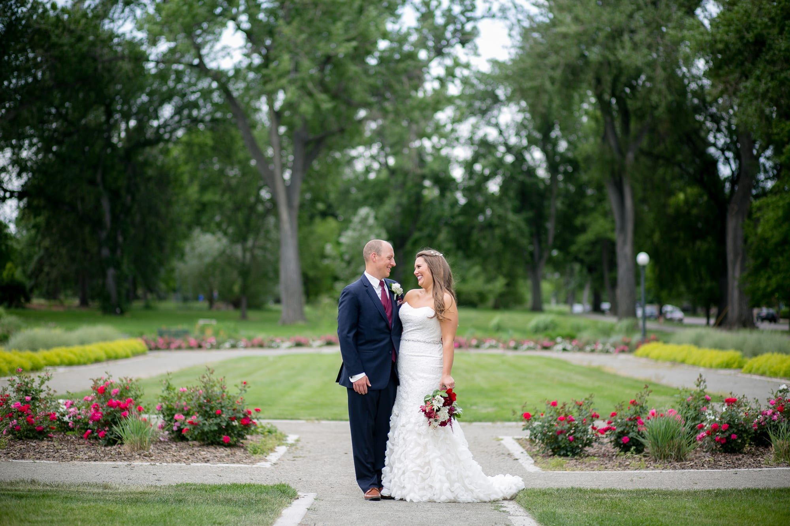

It was a beautiful Saturday evening when Miranda and Josh tied the knot at Wash Park Studio in Denver, Colorado on June 16, 2017. The ceremony was beautiful; they had a small guest list which was perfect for them. Lanterns lite up the aisle as the wedding party made their way down the aisle. Josh walked down with his mom and grandparents. Then all eyes turned as Miranda came down while being accompanied by her father, Pat.

After being announced husband and wife they went to take pictures, by Erinn Magin, at Washington Park while their guests were enjoying the cocktail hour. Once the newlyweds were back at their party, Josh and Miranda shared their first dance together as husband and wife. They danced to “At Last” by Beyoncé as their family and friends shared in their moment. At last, dinner was served by Mountain Crust Pizza and it was delicious! Once everyone was full of pizza it was time to get the dancing started. Miranda and Pat kicked it off first with dancing to “Forever Young” by Bob Dylan for their father daughter dance. Next, Josh and his mother danced to “My Wish” by Rascal Flatts. After, the dance floor was open for all their guests to join and everyone danced the night away.

#museevents #weddinginspiration #coloradowedding #weddingday #denver #milehighcity #weddingplanner #weddingplanning #weddingdecoractions #weddingreception #weddingvendors #weddingrings #weddingdress #weddingideas #colorado #ceremony #blog #photographers
