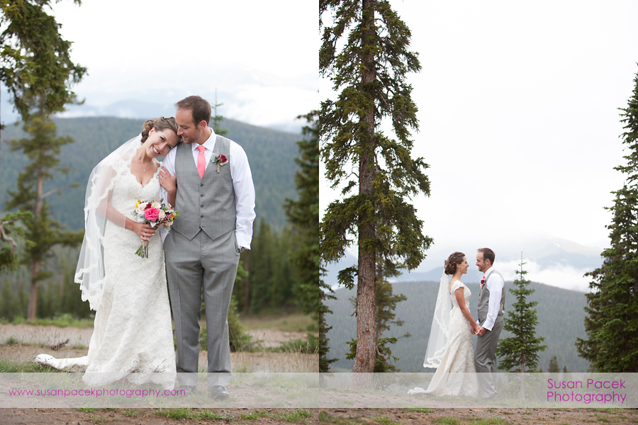

Kaitlyn and Michael celebrated their marriage at the Timberidge Lodge in Keystone, Colorado. The bride wore a romantic lace gown and chose coral and grey as her wedding colors.

Guests arrived via gondola to the top of Keystone Mountain. They were greeted by raspberry lemonade and an array of passed appetizers. The couple exchanged vows in front of the stone fireplace. The reception tables were set with white linens with a burlap lace runner by Muse Events. The gorgeous wood and floral centerpieces by Plum Sage in pink, purple and white. Custom menu’s were tucked into ivory napkins with a rose.

Opening up the dance floor was an impromptu performance by the two darling ring bearers and kept hopping by Standing Room Only. Their day was captured by the talented Susan Pacek Photography and videographer Heath of J9 Video Productions. The wedding cake was provided by Keystone Resorts and was finished in ivory and coral ombre. Their cake topper was an adorable sculpture of the couple in their bridal attire accompanied by their dog. The evening did not end as the bridal party and guests continued to celebrate at an after party at 9280 bar.

