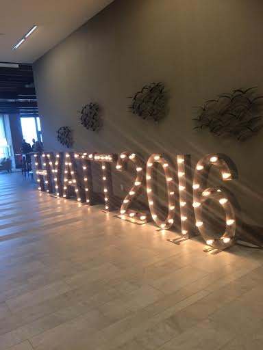
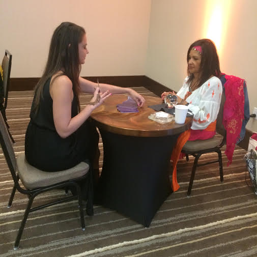
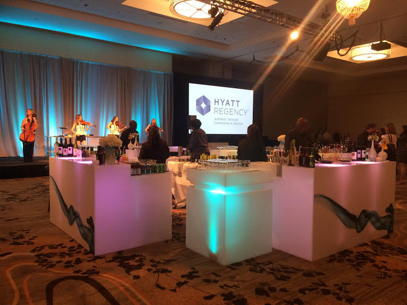
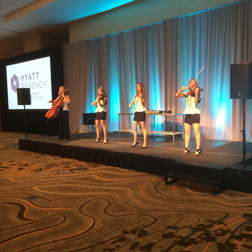
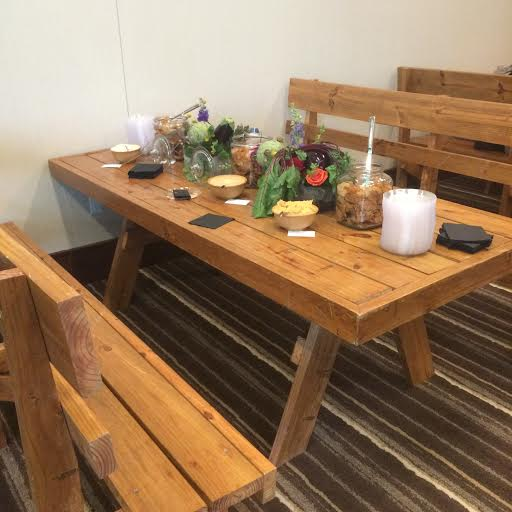
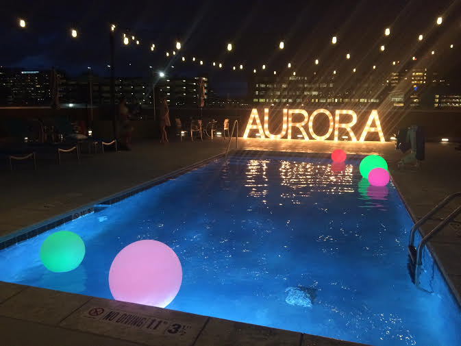

What a night! From the henna tattoos and fortune tellers to the oxygen bar and photo booth, the evening was far from dull. Once arriving, each guest followed a map leading them around the hotel. Going from station to station, each room was a totally different experience. The 10th floor had a view of Denver’s night lights that you couldn’t find anywhere else. When going back down to the first floor ballroom, guests were surprised by live music from Spinphony. The lit up bar, lounge area, and DJ created an ambiance that guests loved.

Champagne, pomegranate glazed salmon, blackberry-nitro cocktails, wood fired pizza, peach margaritas, s'mores; you couldn’t go wrong when choosing a drink or food. There was everything and anything you could want! The Anschutz Medical Campus got it right when saying that each guest would experience wellness of the mind, body, and spirit. I definitely felt enlightened when leaving the grand opening of the Hyatt that night.

#hyatt #food #tattoos #grandopening
