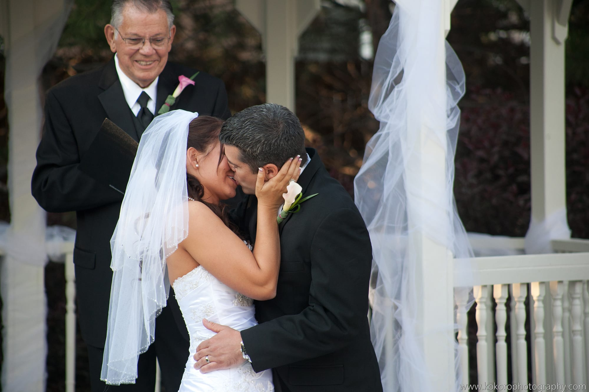

Many couples are quite reserved in everyday life, yet playfulness can make wedding photos come alive. If you are not comfortable laughing on cue, or throwing mischievous looks to your beloved, get out of your comfort zone by practicing in a mirror or with your best friends. Engagement photo shoots are a great way to get used to the camera and working with your photographer. It can be a great rehearsal for your big day and when you see your love reflected in your photos, you will know your wedding photos will capture every emotion plus some flirty, fun ones as well.

Tip: Leave your serious face at home. Smiles and laughter photograph beautifully, and make images come alive.

#bridalgown #museevents #wedding #photography #romantic #weddingdress
