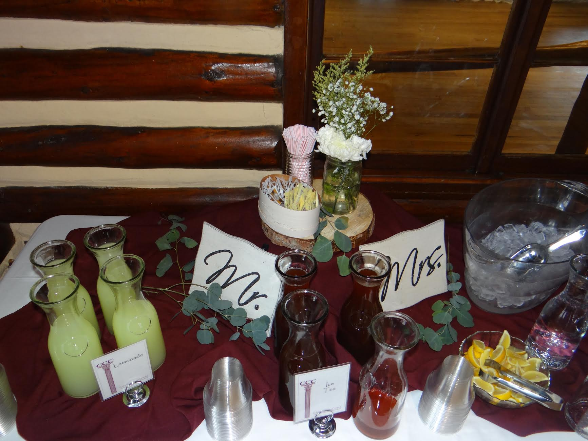
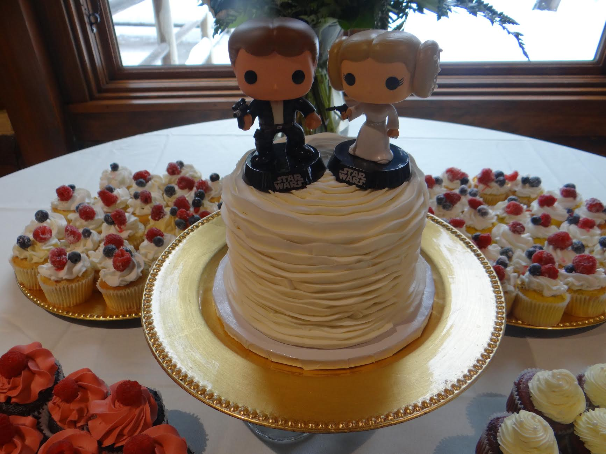

On April 29, 2017, Stefanie and Daniel were pronounced husband and wife in front of their family and friends at the Hampton Inn. The procession began at 5:30pm that evening with the wedding party walking in first. The bride-to-be walked down the aisle with her brother, Scott while in the background the Wedding String Quartet – “Canon in D” was playing. The couple exchanged traditional vows and exchanged rings and after a kiss later, they were pronounced husband and wife.

As the couple went out to take photos by Yellow Paddle Photography, their guests were enjoying the cocktail hour and waiting for the newlyweds to return so the party can begin. After dinner was served by Colorado Catering Company, and toasts were made by the maid of honor and the best man, the new couple could share their first dance together while the song “I’m Kissing You” was playing in the background. As the night was coming to an end, the last song that played was “I Had the Time of my Life” and they sure did!

Photography: Yellow Paddle Photography

#hamptoninn #vows #rings #yellowpaddlephotography #coloradocateringcompany #toasts #happycouple #wedding #weddingrings #weddingreception #weddingvendor #weddingideas #vow #photographer #weddingplanner #weddingplanning #weddingdecorations #weddingday
