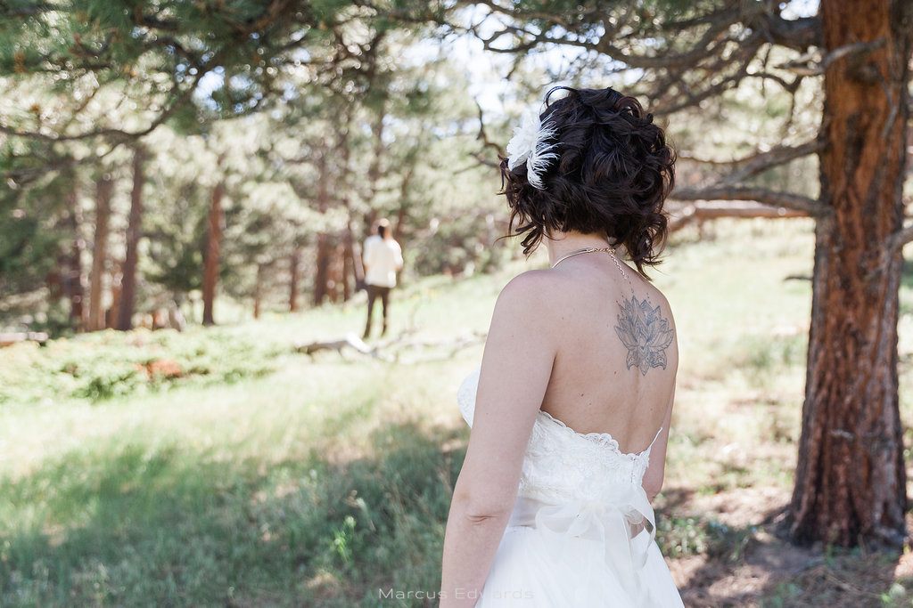
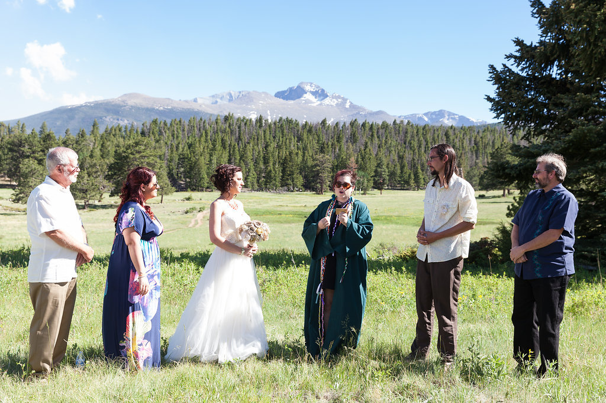

On a hot summer day in Estes Park, encircled by thirty of their closest family and friends, Courey and Travis literally tied the knot with a beautiful ceremony in which cords were tied around the couple's hands to symbolize various aspects of their marriage.

Following the ceremony, the couple and guests quickly drove to the cabin where the couple had their reception! For dinner, the couple chose pulled pork and fried green tomato sliders, a make-your-own grilled cheese bar, and a delicious chipotle Caesar salad.

They played the shoe game which was received with TONS of laughter. Then Friends and Family spoke kind words about the fun loving couple.

For dessert the couple served s'mores and an array of sweet treats. Tossed the bouquet, a top a picturesque hill in Rocky Mountain National Forest.

The couple chose to have a relaxed night with friends and family, and they spent time with the people who loved them most. Congratulations Courey & Travis!!!

#weddingseason #weddingplanner #weddingplanning #museevents #weddinginspiration #coloradowedding #summerwedding #estespark #tietheknot #wedding #coloradobride #weddingstyle #weddingideas
