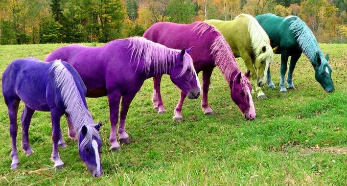

Come checkout Muse Events at the Eclectic Wedding Showcase

Tuesday, October 1, 2013 6:00 pm – 9:00 pm at MILE HIGH STATION 2027 Lower Colfax Avenue, Denver 80204 www.milehighstation.com

Get ideas to enhance your wedding or event

-   Over the top vignettes in offbeat themes

-   See Denver’s most creative Event Professionals strut their stuff

-   Local Designers show off the latest in glitz & glam for unique Brides & Grooms

-   Giveaways, Goodie Bags, and a few surprises

-   Find everything you need in an exciting and fun atmosphere

-   Eat, Drink, & Be Merry

Entertainment provided by: A Music Plus, Hipster Mama Productions, Lannie’s Clocktower Cabaret, with Special Guests, “Ready Never”, and the biggest name in Denver Drag, Ginger Sexton!

Tickets are $5 in advance, $10 at the door.

With unique and offbeat weddings becoming more and more popular, this show will feature vignettes from Denver’s top creative event professionals who thrive in the eclectic. Teams made up of these creative pros will showcase a handful of outrageous themes, a complete vignette from top to bottom (think “Pinup Rockabilly”, and “Comic Book Super Hero”, and “Victorian Goth”, just to name a few). Other entertainment includes a visually stimulating Fashion Show that even Dior & McQueen would die for, goodie bags (because who doesn’t like those, right?), give-aways, and a few surprises along the way.

This event is for everyone, not just the “offbeat”. Sure, it will be visually over-the-top and badass, but that’s just because it’s super-fun and different! Even more traditional couples may get a couple of little “nuggets” on how to make her wedding event more personable. I’m pretty sure the guys will love too this since it’s not typical.

