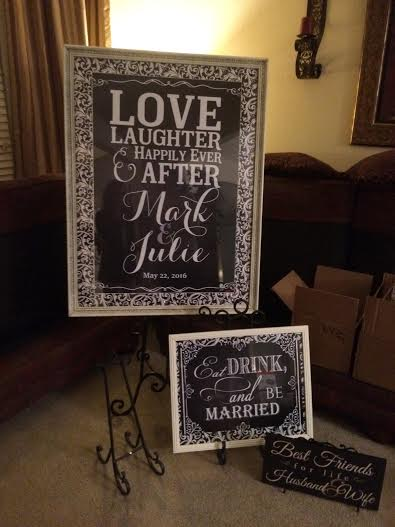
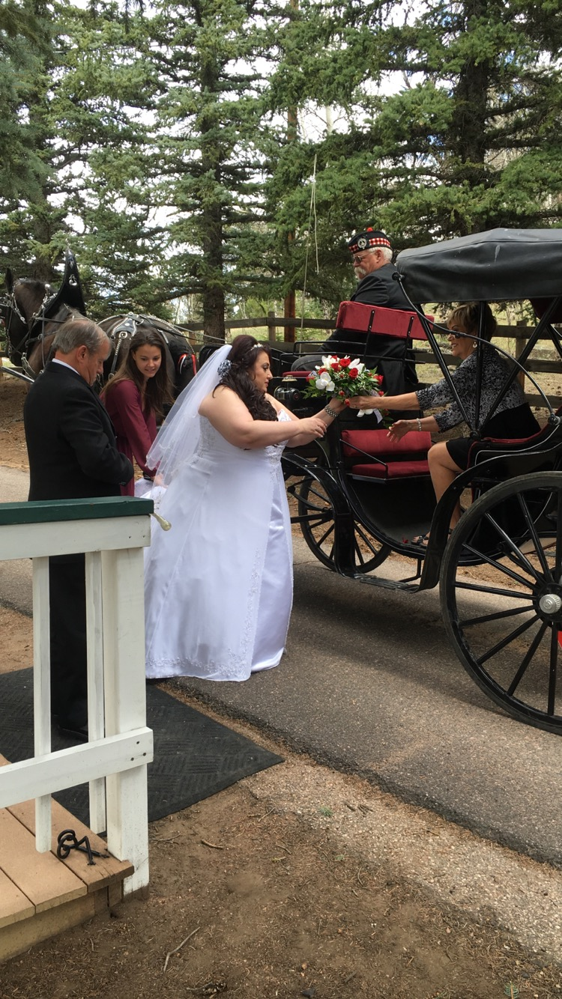
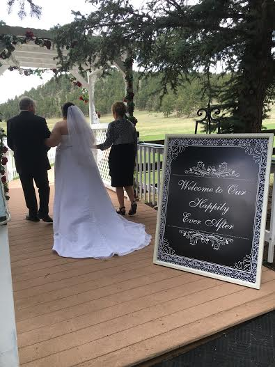

Julie and Mark could not have been happier the day of their wedding. Mark’s anticipation of seeing his bride had him smiling all the way down the aisle. All heads turned when Julie arrived at the ceremony in a horse drawn carriage. Her dress was gorgeous and the ceremony space matched her beauty with flowers and hearts everywhere to be seen.

After the ceremony, guests walked down the pine tree lined road towards the barn where the reception was held. The room was surrounded by beautiful wooden rose hearts, and the couple’s theme of black and white damask highlighted the barn with amazing table runners and beautiful centerpieces, that the couple made themselves. After a fabulous dinner catered by Relish, the couple had their first dance as husband and wife. Every single person had a huge smile on their face as the couple twirled around the room. Afterwards, each guest was given a balloon for a ceremonial balloon release to send some light out to the world, with wishes and prayers. The guests carried on the evening and danced the rest of the night away while eating a delicious black and white fondant cake. The night really was magical to every guest and especially the newlyweds. It was a night that will be remembered.

#horsedrawncarriage #barn #blackandwhite #museevents
