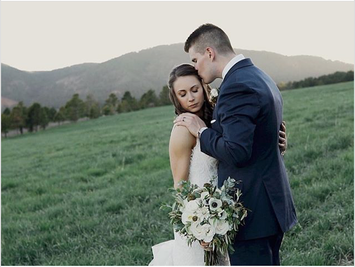
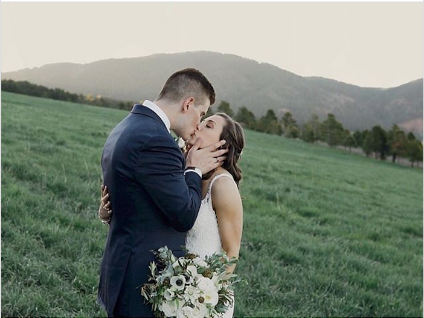
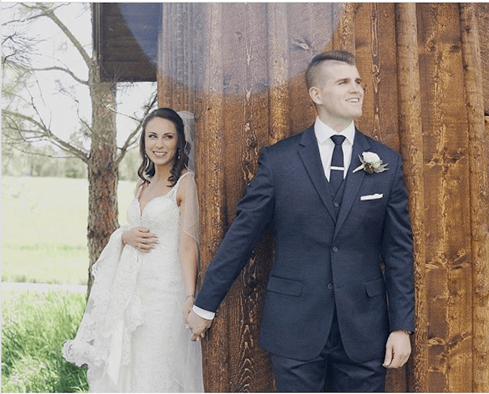

It was Mackenzie and Larkin’s wedding day and they were both excited to get their day started. They agreed not to do a first look but they wanted a picture of them holding hands not looking at each other which was perfect!

Once it was 4pm, it was time for the ceremony to begin. As the bridal party made its way down the aisle it was time for the bride to walk down. They had a traditional ceremony but they added something else – Wine Box Ceremony. The Wine Box Ceremony is when the couple locks a bottle of wine in a box and open is later in their marriage to enjoy. As soon as vows, rings and a kiss was exchanged, they were pronounced Mr. and Mrs. Jacobson and it was time for the celebration to begin!

The newlyweds shared their first dance together as the song “When you Got a Good Thing” by Lady Antebellum played in the background. Then the couple and their guests could enjoy dinner that was catered by Occasions Catering and everyone loved it! The couple snuck away for a little to captured sunset photos that were taken by Kate Lyon. After they rejoined their party, they danced the night away with their family and friends.

Photography: Kate Marie Photography

#wineboxceremony #occasionscatering #katemariephotography #graceschapel #happycouple #wedding #weddingdress #weddingrings #weddingreception #weddingvendors #weddingideas #vows #photographer #weddingplanner #weddingplanning #weddingdecorations #weddingday
