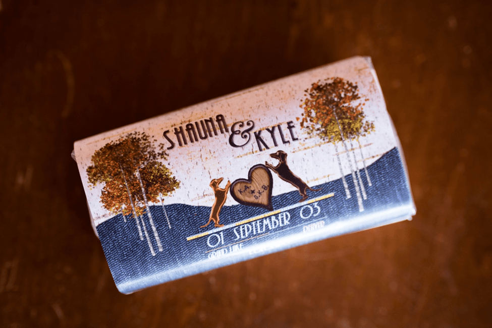
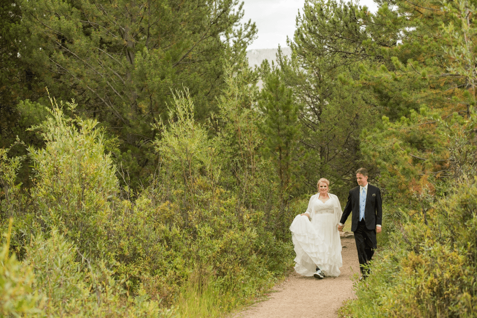
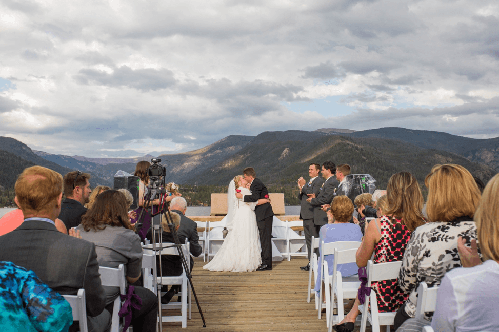
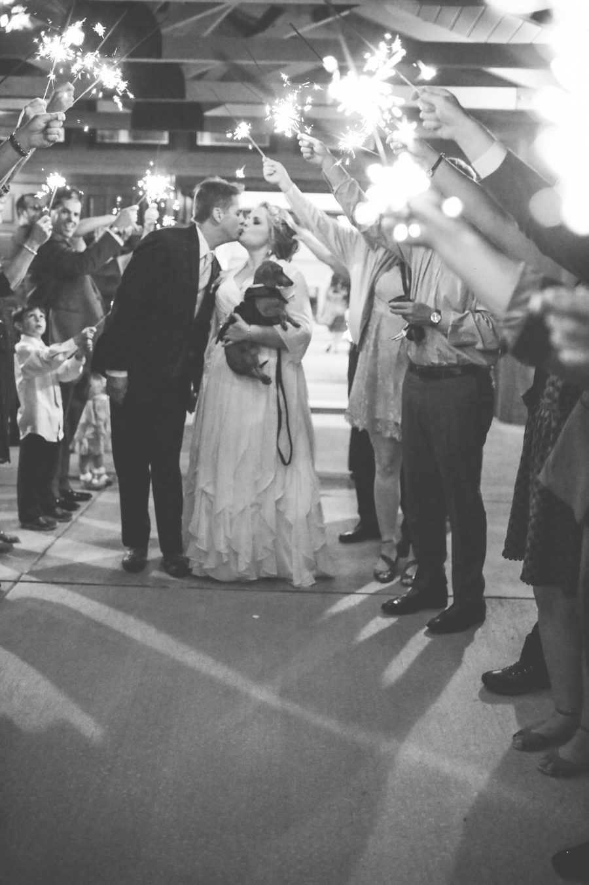

It was the morning of Shauna and Kyle’s big day and it was a perfect day to celebrate these two individuals coming together to start their lives as one. The lucky husband to be was able to see his beautiful bride before the ceremony started since they decided to have a first look. She took his breath away and you felt the love that these two had for each other.

The ceremony started promptly at 4:00pm, the bridal party walked down the aisle and then the bride – to – be walked down with her father, Richard. During the ceremony, they exchanged vows and rings. They had added an additional touch to their wedding that made it unique, they had a rose ceremony. The rose ceremony is a way of honoring their mothers or other family members for their gratitude of the love that was bestowed upon them and it is the first gift the bride and groom give to each other as husband and wife.

Once the ceremony was over, it was time to start the party! Their reception was held at Silver Creek, Colorado. They were having the time of their lives being able to celebrate with their family and friends. The newlywed couple snuck away from their party and partook in sunset photos that were breathtaking. Once they continued to party a little more, it was time for them to depart. They decided to have their guests hold out sparklers for their exit and it lite up the night.

Photography: Brian Paul Mallik Photo

#firstlook #roseceremony #silvercreek #sunsetphotos #museevents #weddinginspiration #beautifulcoloradowedding #happycouple #wedding #weddingdress #weddingrings #weddingreception #weddingvendors #weddingideas #vows #pointpark #weddingplanner #weddingplanning #weddingdecorations #weddingday #brainpaulmallikphoto
