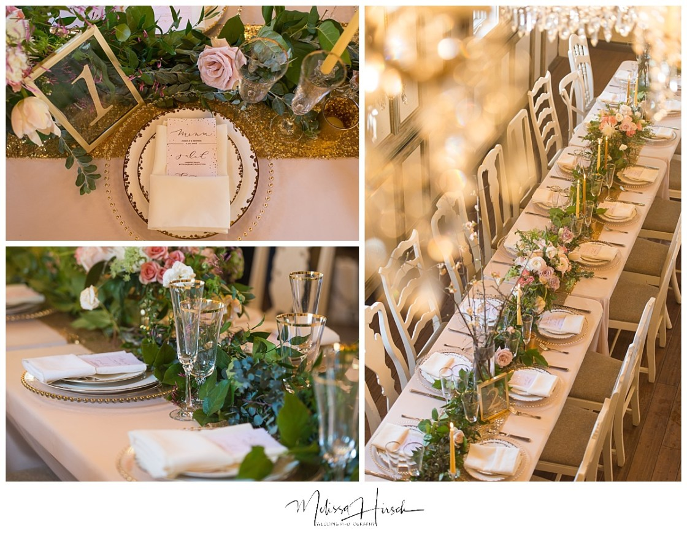
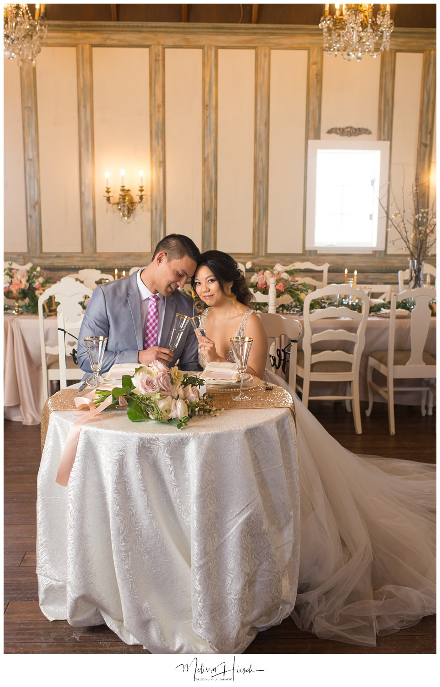
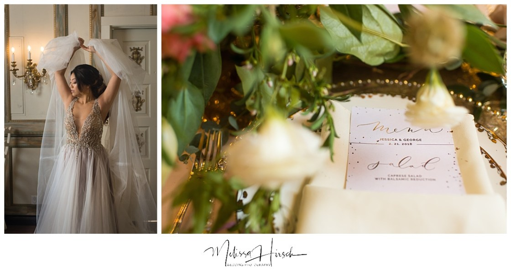
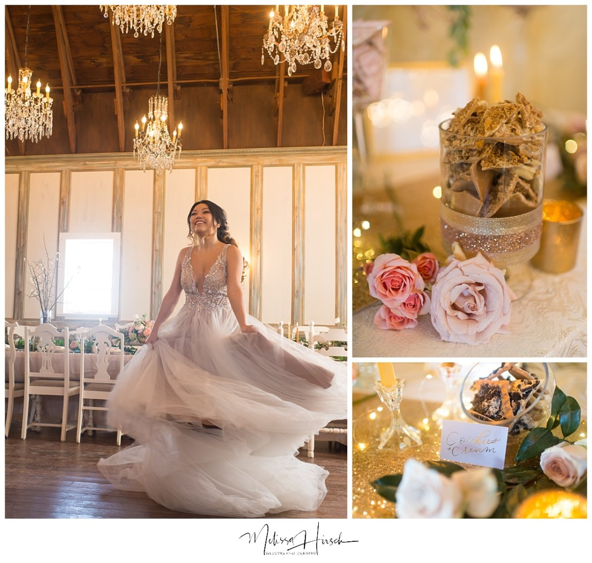
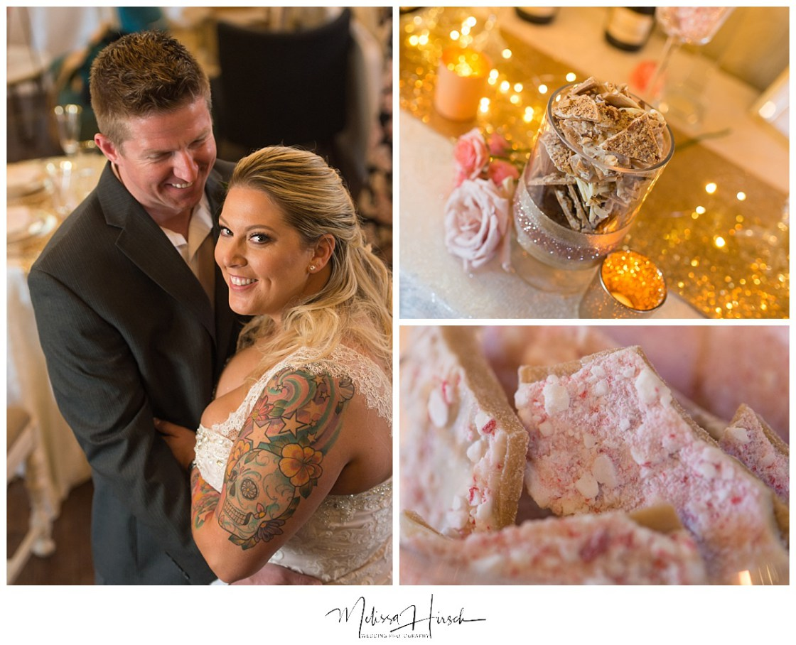
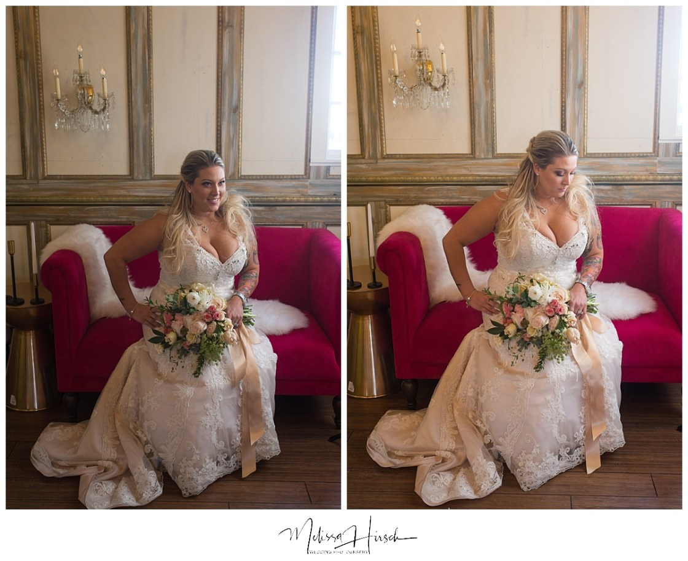
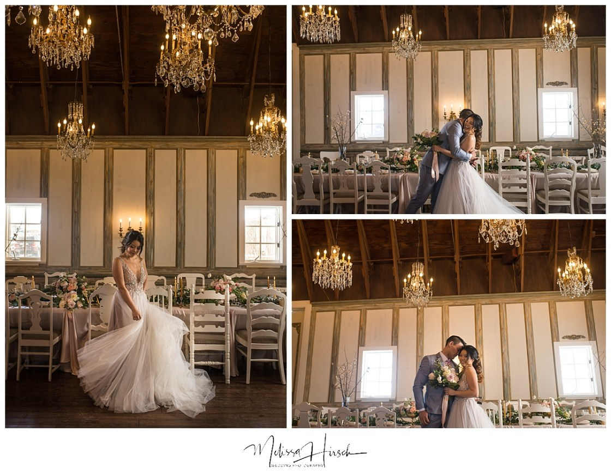
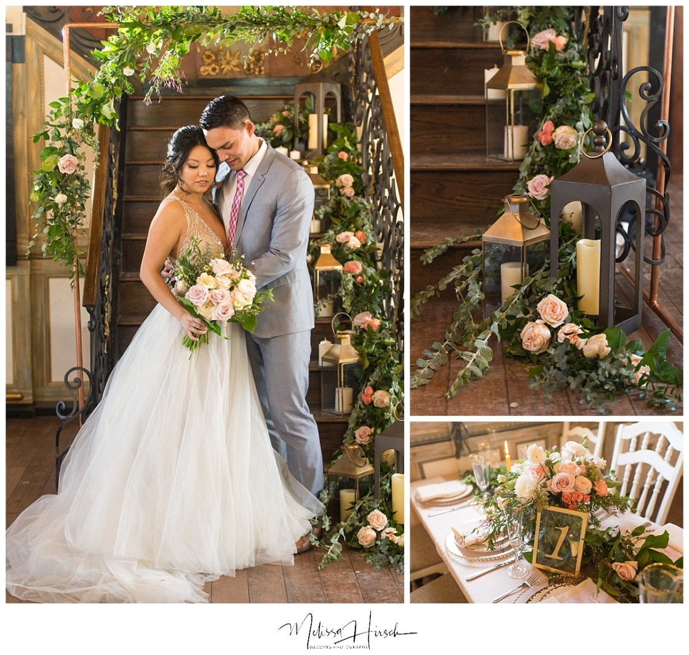

Check out this amazing blog post by the artistic Colorado Wedding Photographer Melissa Hirsch Photography! The post entails how to build the perfect wedding photo timeline from a recent Chandelier Photoshoot we held at Lionsgate's Chandelier Barn!

Anyone can be a wedding photographer with amazing gear, perfect lighting, and a timeline followed to a T. But what separates the professional artistic Denver wedding photographersfrom the rando photographer on Craigslist is what happens when the gear isn’t amazing, when the lighting isn’t perfect, and when the timeline completely goes off the tracks.

As a the happy couple, the lighting and gear are squarely NOT your responsibility – that’s up to your artistic Denver wedding photographer!

While every single wedding has a slightly different timeline and flow (and therefore YOUR wedding timeline should be custom-built with your photographer), there are still some considerations every couple can think about ahead of time.

### THREE WAYS TO PLAN THE PERFECT WEDDING PHOTO TIMELINE

### EXTRA TIME

Here’s the truth: I’ve photographed maybe one wedding where everything happened on time. Seriously, you plan and plan and plan, and then day of, weddings take on a life of their own. And it’s not a bad thing – it’s how it should be. However, to get even MORE real for a minute, your photo timeline is usually what gets squeezed. Why, you may ask? Your dinner needs to be served as soon as it’s ready – it’s totally non-negotiable. So, photos are the only part of your day post-ceremony with wiggle room. This is why it’s pivotal to overestimate your photo timeline. If the day falls behind, you still have time to get the photos you need. If it doesn’t fall behind, you have extra time to get photos you’ll love forever – or maybe head to the party early! Win-win.

### DENVER FORMAL WEDDING PHOTOS

Plan for formal photos. As you may know, this is one I’m passionate about. I’ve never heard any client or photographer say, “I LOVE the family formal shots!” I get it. It’s not always fun. By the end of them, your cheeks are numb and you need a drink. But, let me tell you what I have heard: “At my sister’s wedding, we didn’t get a photo with my grandfather.” “My best friend’s aunt passed away just after her wedding, and there were no photos of her.” “My brother got a bunch of photos of people he didn’t know, with just one photo of our great-grandmother.” This is the reality of your wedding photos. It’s SO worth taking that time away from your celebration to honor the people who brought you here. I promise.

### PHOTOS OF THE TWO OF YOU

Set aside time for photos of JUST the two of you. It’s so easy to get caught up in the celebration that it’s tough to take time away from the party. But again, I promise it’ll be worth it! While enjoying your guests is a HUGE part of your wedding day, it really is ultimately about the two of you and the beginning of your new life together.

Ultimately, you’ll want to custom build your timeline with your artistic Denver wedding photographer based on your vision for your day. Trust your photographer’s expertise, but you have the final say.

If you liked this blog post, check out the three ways to RUIN your wedding photography.

Looking for even more tips? Sign up for my email list and get your FREE guide: Don’t Hire Your Wedding Photographer Without Asking These FIVE Questions!

PS How about this styled shoot?! OH my goodness, SO pretty.

Here are all the amazing friendors who came together for this shoot:

Planning: Muse Events

Venue: Lionsgate Event Center

Florist: Atmosphere Flowers

Dress: Anna Be

Paper + Calligraphy: Pretty Things and Letterings

Rentals: Allwell Rentals

Lounge/Decor: Wallflower Rentals

Sweets: Miss Kelly’s Candies

Champagne: Party Liquor

HMU: Bronze and Beautiful + Beauty on Location
