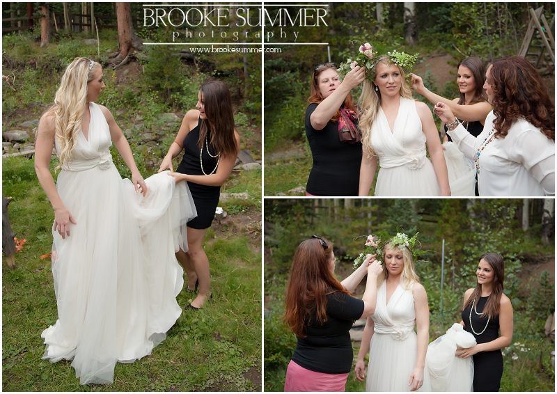

Planning for a wedding can be fun, but can also be very stressful. While trying to find a DJ or band, a caterer, a venue to have the wedding, finding what kind of dresses, what type of food you want, how many people to invite, how you want your ceremony and reception to be set up, and still having to go to work and live everyday life can be very time consuming. That why Muse Events is here for you to help you plan your perfect wedding. So why is it easier to hire an event planner versus planning your own wedding?

First off, we will make sure you are staying within your budget. In the article “Top 10 Benefits to Hiring an Event Planner”, the author mentions a lot about how hiring an event planner can benefit somebody and the author mentions their experience with an event planner. They state, “Susan Phillips helps clients navigate price tags and balance their priorities to stay on or under budget” (“Top 10 Benefits to Hiring an Event Planner”). As an event planning company, we are here to help you and work with your budget and still give you the perfect wedding.

Another reason to hire an event planner is because we are here to help communicate with others. For a wedding, a goal is to always find a great caterer, florist, cake designer, and venue. That is what Muse Events is here to do. We are here to help you find all of those great sources for your wedding. On Angie’s List, an article was written about “Why Hire an Event Planner?”. The article states, “The wide network of contacts with service providers the experienced event planner has established over the years allows him or her to get good deals which will in turn be of benefit to you, hence saving you time and money” (“Why Hire and Event Planner?”). We are here to help you network to find your type of vendors for you.

Another reason to hire an event planner is we are also here to is help with organizing the wedding versus forcing the bride and groom to do it all on their own. In the article “5 Key Benefits of Hiring a Professional Event Planner…”, the article mentions the reasons of why an event planner can help the organization process. The article states, “At the end of the day, the right planner will serve as an extension of you. They do all the “heavy-lifting” so that you can be a guest at your event or outing and provide you the opportunity to network effectively to make a favorable impression that will long be remembered by your guests” (“5 Key Benefits of Hiring a Professional Event Planner”).

We are here to help you organize your wedding and make your wedding as stress free as possible. Our goal at Muse Events is to help you reach your goal for what you want to do for your wedding. We are here for you so let’s start planning!

Works Cited

http://sgpconferences.com/top-10-benefits-to-hiring-an-event-planner/

https://www.angieslist.com/articles/why-hire-event-planner.htm

https://www.linkedin.com/pulse/5-key-benefits-hiring-professional-event-planner-houston

#eventplanner #budget #wedding #ceremony #reception #museevents
