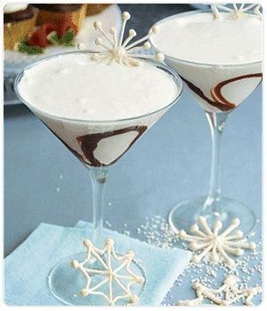

The PERFECT whimsical drink for the Holiday Season! Being that the Holiday Season is right around the corner what better drink idea whether it is for a fun girls night in or a special event! Muse Events is having so much fun planning holiday parties, check out this cocktail below! Prep time: 10-15 mins Serving Size: 2 Ingredients 1/2 cup half and half cream 4 ounces of white chocolate, roughly chopped 2 ounces of Vodka 2 ounces Simple Syrup (see recipe below) Chocolate Syrup (optional) How to make Simple Syrup: You need 1 cup water 1/2 cup sugar 1.) Pour water into a pot and place the pot on the stovetop 2.) Turn the stove on high heat bringing the water to a rolling boil 3.) Add sugar to the boiling water 4.) Stir the sugar and water mixture with a spoon to help dissolve the sugar 5.) Continue to cook and stir the mixture until all of the sugar has dissolved into the water and the mixture has a syrup like consistency 6.) Remove the pot from the heat and allow the simple syrup to cool 7.) Transfer the simple syrup into a container and store the covered container in the refrigerator Martini Directions 1.) Heat the half and half cream in a small sauce pan; slowly add white chocolate, whisk continually until chocolate is fully melted. Cool down to room temperature. 2.) Add Vodka and simple syrup to white chocolate mixture and stir to blend 3.) Pour into two martini glasses and serve. 4.) For extra pizzazz add chocolate syrup and swirl on the insides of the glass for a fancier occasion!

#museevents #cocktail #wedding #winterwonderland #holiday #drink #eventplanning #holidayparty #muse #drinks #blog #weddingtrends
