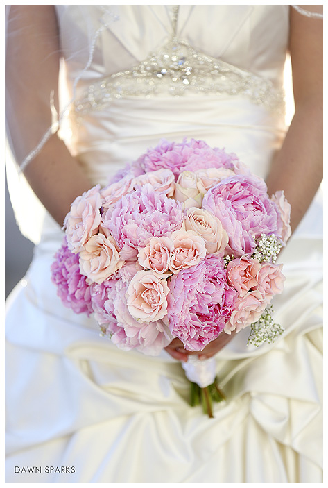

A wedding is the personal expression of two very special people; the bride and groom. It is an evening of romance and surprise, of grace and refinement, dignified in presentation and tasteful in manner and in appearance. Most importantly, the finished masterpiece is in honor of the unity of two lives coming together all within a planned budget.

I am a firm believer that in life there are always rules to follow, and planning an elegant wedding is no exception. Anything you wish can be obtained, as long as you are willing to pay for it.The first step to the planning of any event should be to establish a realistic budget. Create a “Wish List” of everything you envision for your special day. However, there are points of planning that can be placed in the “compromise” column. Prioritize the items on your wish list by personal importance.

Revisit the guest list. Often times, in order to obtain a level of elegance and still maintain the items of importance on this special day, you will likely need to narrow down your list. Your wedding should be a very special day and the guests that surround you should be equally as special.

The next step is to find the right vendors. A wedding planner can help you manage your budget with vendor recommendations and unique ideas to express your vision with an eye to saving money. The perfect venue will present your guests with a backdrop of a fabulous celebration. To capture your day place an emphasis in your budget for a world class photographer. This day is a once in a lifetime dream, you want a professional to document every intimate moment. If your venue does not come with catering, take your time and choose a caterer who can create a delicious wedding feast with all the trimmings within your budget. Not least of your decisions is your entertainment. There are so many options to choose from. Choose Big bands, celebrity DJ’s, Elvis or Frank Sinatra impersonators for musical entertainment and setting the party atmosphere.

There are so many unique elements of design that can transform a basic ballroom into a dream. Custom dance floors, chandeliers and room up lighting, gobo’s of your monogram on the dance floor, centerpieces overflowing with flowers and candlelight. All of your wish list combined to create the wedding of your dreams. All you need is a budget, a wish list, a wedding planner and excellent vendors.

#wedding #elegantwedding #weddingplanner #budget #reception #entertainment #catering #photography #museevents #dream #blog #life #love #weddingideas #weddingtrends #relationships #beauty #eventplanning
