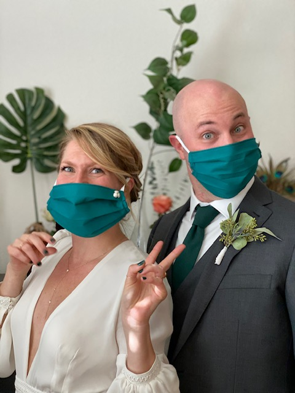
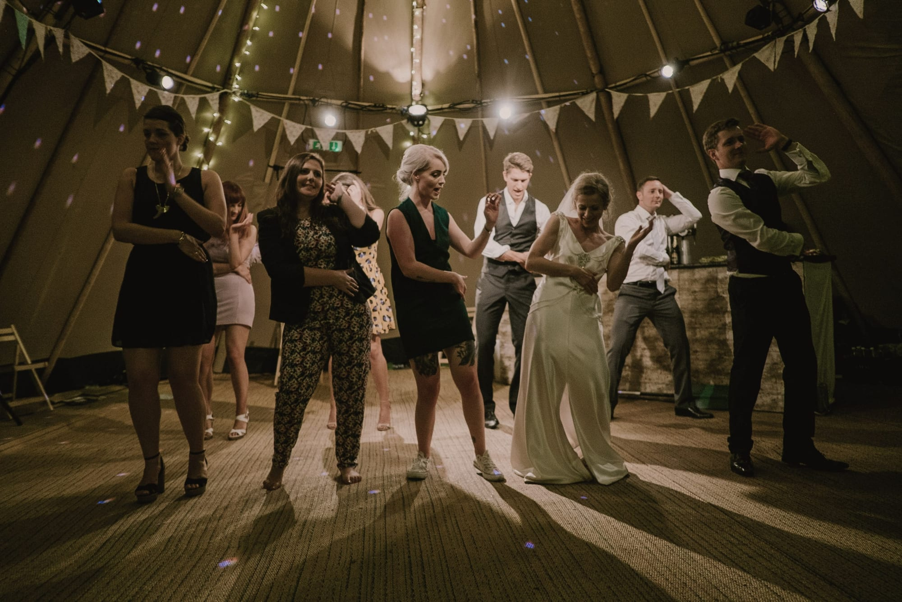
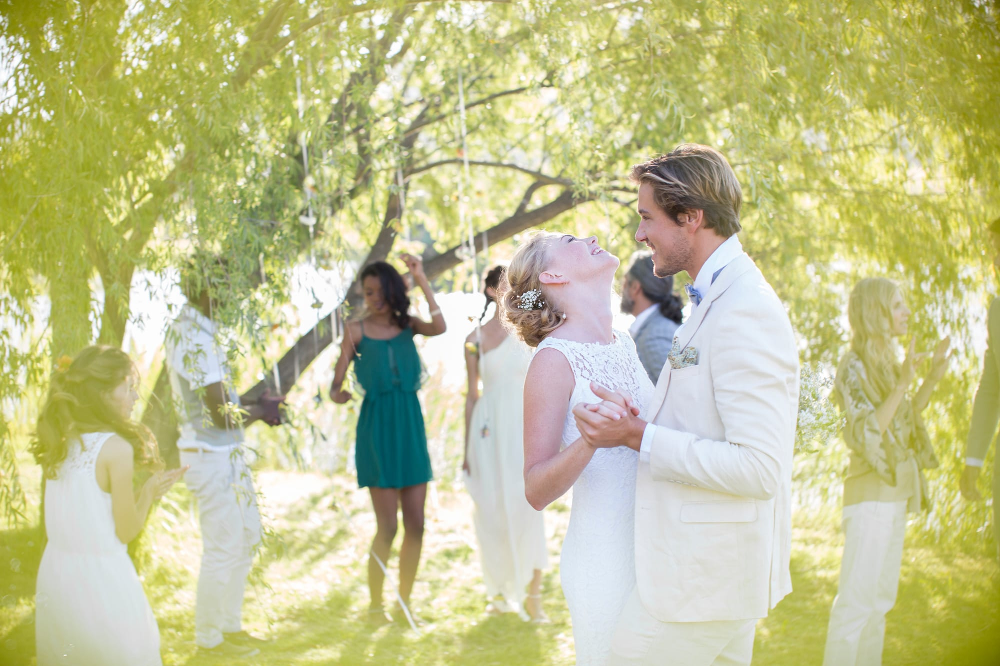

With the COVID-19 pandemic, weddings around the world have been put on hold. But the pandemic does not need to signal the end of your dream wedding. Whether gathering virtually with your friends and family or hosting a small, intimate ceremony, your wedding can still be a dream come true.

**Zoom Weddings**

As many large wedding celebrations have been postponed, you may have seen a few more “Zoom” weddings. While named after the popular video conferencing app, these weddings include any shared publicly through video sharing: YouTube Live, Facebook Live, Instagram Live, etc. This is a great option for people who just want to get married but also want to share the special ceremony with their friends and family. For these ceremonies, you can invite a small wedding party and a handful of family members, being careful to stay below your area’s maximum for social gatherings. If you don’t know your area’s protocol, a quick Google search should help you out. You can also follow these links to the Colorado government’s page on [Indoor](https://covid19.colorado.gov/safer-at-home/indoor-events) and [Outdoor](https://covid19.colorado.gov/safer-at-home/outdoor-events) events for more info. If you would rather not have your officiant take up one of the precious few spots, they can officiate virtually, or even better, you can have a family member or close friend officiate, as there is no need to be ordained in CO. All of us at Muse Events cannot wait until we can have large, 200+ celebrations again, but for the time being, it is safer to keep things small. A Zoom wedding is a great option for those wanting to get married sooner rather than later, and since they are very cost effective, you can still hold a larger “sequel” celebration in the future.

**Minimony**

If the idea of live streaming your wedding doesn’t quite feel “right” for your special day, there are still other options! Rather than have a Zoom wedding, you can have a small minimony – a wedding ceremony of up to ten people. Like in a Zoom wedding, the officiant can be in-person or virtual, but unlike in a Zoom wedding, you may consider still using some of your vendors that you planned to use on your wedding day. At the minimony, you may have a mini wedding cake provided by your pastry chef, a small buffet provided by your caterer, and small arrangements from your florist. You may also consider inviting your photographer to document the special event but be wary of your ten-person limit. By using your vendors, you can support them in a time that they are taking a particularly large hit, but that also means that the minimony will cost a bit more than a Zoom wedding. Still, there should be plenty of room in your budget to allow you to host a “sequel” wedding down the line, having the celebration that you dreamed of without having to wait to actually get married.

**Zoom Minimony**

As you can probably guess, a Zoom minimony is a mix of the first two wedding options, allowing you to have your entire guest list watch your wedding while also utilizing your vendors. If the idea of planning two celebrations does not appeal, this may be the option for you! You can create a spectacular wedding, using your pre-established budget. While you may still be limited to only ten people in attendance, you can try and bring the wedding to your guests! By sending your guests their own mini cakes and party favors, you can show them your appreciation for taking part in your special day. And even though you cannot mail food to your guests, you can certainly mail out vouchers to allow them to eat dinner with you. Once the party begins, you can entertain your guests virtually as well. Many online video conferencing platforms support “breakout rooms,” where people can travel to different rooms to see different things. Maybe in one room you have your mixologist waiting to walk people through the steps of making drinks (you can even send your guests a cocktail kit that can double as a favor), and in another room, you have a magician waiting to wow your guests with their illusions. Still, in another room, you can have a digital photo booth that can allow people to use virtual props when taking pictures. Your Zoom minimony will be remembered forever and can be just as meaningful as a large in-person event.

So that’s three ideas for how you can still have your dream wedding, even with the COVID-19 restrictions. Your wedding may not look the same as you initially planned, but the feelings and love attached to your special day will never change. Don’t let COVID-19 slow down the rest of your life; you can still “zoom” to the altar with these creative ideas!
